# 第一章 设计因素对于皮划艇性能的影响

解析皮划艇的各个参数对于皮划艇整体性能的影响。 从稳定性，船体形状，设计速度等角度出发，进而根据我们 的需求来合理设计符合我们需求的皮划艇。

## 第一节：两种最基础的皮划艇设计原型

在这里首先明确一下名称的问题，皮划艇是我们在中国内地地区习惯上的名称，指的是一种单独船型，包含海洋舟、激流艇等有密封仓的样式。但在国际上是包含了两种不同样式的产品：皮艇（kayak）和划艇（canoe）这是两种不同风格的船。参见下图。而我们习惯上的叫法中皮划艇是代表皮艇 kayak 的。在本书中我们为了符合习惯，统一的把皮艇（kayak）称为皮划艇，而把划艇（canoe）称为独木舟。用这两个名称来区分皮艇和划艇。

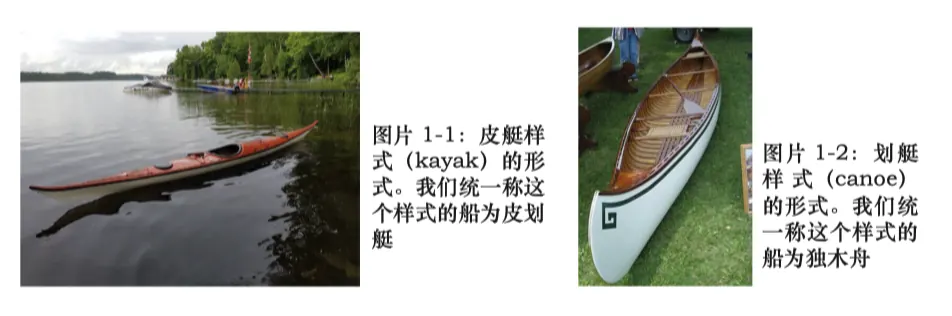

**图片 1-1：皮艇样式（kayak） 的形式。我们统一称这个样式的船为皮划艇。**

**图片 1-2： 划艇样式（canoe）的形式。我们统一称这个样式的船为独木舟。**

比较公认的说法皮划艇是格陵兰岛上的阿留申人和因纽特人发明的，他们制作一种小船，这种小船用鲸鱼皮、水獭皮包裹在鲸鱼或者其他动物的骨架上，用两端有桨叶的船桨划动。这种小船就是我们现在的皮划艇。他们依靠皮划艇在北冰洋的恶略环境下捕鱼狩猎，是他们赖以生存的工具。因为环境、获取的材料以及狩猎捕鱼需求等因素影响，他们需要机动灵活安静的船只，于是就形成现在皮划艇的狭窄形状，单人操控的风格。

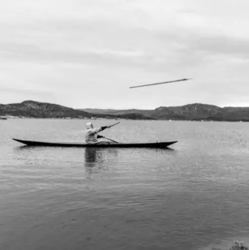

**图片 1-3：图片由格陵兰中国的舟行者提供 因纽特人（Inuit）用投掷器（Norsaq）投掷长矛狩猎**

经过几代人甚至几十代人的优化和精心打磨，皮划艇这个他们赖以生存的工具已经可以完美的适应了各式各样的环境。

由于阿留申人和因纽特人的生存环境不同，对于皮划艇的需求也不同，这样形成了两种基础的设计风格。阿留申人的生存环境是宽阔的海洋，没有太多的阻碍，狩猎捕鱼的距离比较远，他们对于速度要求比较高。形成了阿留申人的皮划艇基础样式。我们称为白达卡尔（baidarka 俄语：小船的意思）。而因纽特人的生存环境更复杂多变，需要有更多的灵活性来应对这样的环境。形成了西格陵兰因纽特皮划艇的设计样式。这两种设计样式都非常优秀。时至今日，我们依然可以在看到一条皮划艇的时候可以分辨出来是以哪种基础方案为原型设计的。

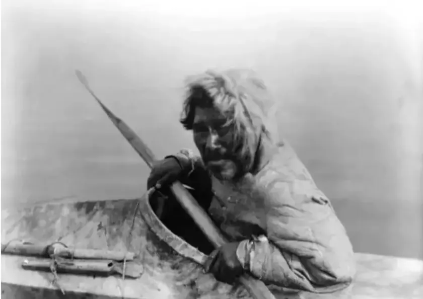

**图片 1-4：图片由格陵兰中国的舟行者提供 因纽特猎人。**

你可能会问为什么不建造更大的船？这个有很多的因素综合促成的。北冰洋地区没有什么树木，基本材料来源就是海洋中飘来的浮木以及动物的骨骼，这样的材料来源已经决定没有办法建造更大的船只。爱斯基摩人通过划艇人的技术来弥补稳定性的不足性，大大的增加了速度和灵活性。这样的速度和灵活性，也可以抵抗很多的大船抵抗不了的风浪。更利于爱斯基摩人的生存。同时也就决定了皮划艇的体积不会很大。

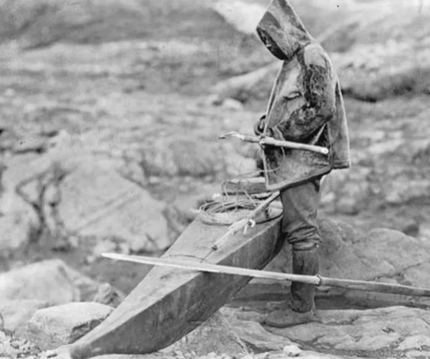

**图片 1-5：图片由格陵兰中国的舟行者提供 因纽特猎人。**

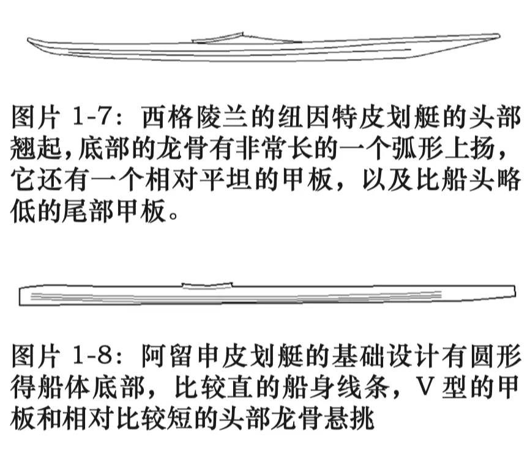

从以上的两个图形中可以明显的对比出来两种不同风格皮划艇的设计要素。不过当代的皮划艇很难明确追溯到他们的祖先是那种风格。因为现在的设计要素已经都根据需求进行了优化融合了。风格的区分只能从船头的形状来大体定义属于哪一种。皮划艇的头部龙骨有长翘起的悬挑，属于格陵兰的纽因特皮划艇，皮划艇的头部短平直的，属于阿留申皮划艇的分支。不过这个区分方式也不能准确定义，只能笼统的划分一下。

## 第二节：稳定性

我们确定好使用哪种皮划艇设计原型后，我们也是可以灵活的来设计我们想要的皮划艇。你可以根据需求做很多的改变。需要注意皮划艇的各种设计参数，都是相互制约的，你比如你增加了速度参数，就会影响稳定性。增加了稳定性，会影响灵活性。我们分开讨论一下皮划艇设计中主要考虑的因素。

我们玩皮划艇的时候，经常会被围观，很多人对皮划艇比较感兴趣，他们问最多的问题就是“你不担心这个船会翻吗？”。皮划艇又长又窄，看起来就会觉得很不稳。对于刚接触皮划艇的人来说，稳定性往往是最大的问题。常识经验会告诉我们宽一点的船会比窄一点船的更稳定。但是这个简单的经验没有解释稳定性是什么原理。是由什么因素确定的。各个因素之间的关系是什么。

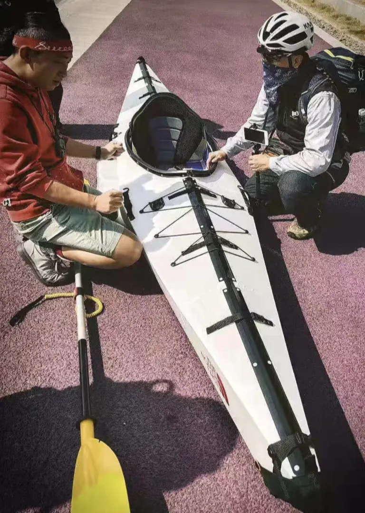

**图片 1-9：图片由施溥提供。产品为澎逸折叠皮划艇。**

船舶的稳定性是指船舶在有限的作用下不会倾覆，倾侧力消失后能恢复到正常状态的能力。是由船舶的重心、浮心（船体排开的水的重心），漂心（水线面积中心）、水面上面积、船体形状以及减摇装置（比如舭龙骨）决定的。在皮划艇上，稳定性就是皮划艇的重心和浮心的位置关系。人做在皮划艇上，人和皮划艇的总重量决定了质量重心，而皮划艇排开水的体积决定了浮心的位置。质量重心位置是稳定的不会变化，浮心的位置随着倾斜角度的变化跟随皮划艇形状而改变。只要两个中心垂直对齐，船就会保持直立。如果质量重心比浮力中心更接近中心线，皮划艇会被浮力推着恢复垂直，这个时候皮划艇是稳定的。当质量重心超过浮力中心之外后，皮划艇会加速倾斜，直到倾覆。这时候皮划艇就不稳定了。皮划艇变得不稳定的角度取决于船体的形状和重心的高度。船体形状决定了浮力中心的位置。重心高度决定了质量中心的位置。

我们在设计皮划艇的稳定性的时候，用的是扶正力矩这个定义。力矩是力和力的作用点到支点距离的乘积。在皮划艇中，右倾的时候是从重心到右舷的距离乘以所排开的水重量。当皮划艇垂直漂浮的时候，因为质量中心在中心线上，所以复原的力矩为零。我们力矩的单位是牛顿*米，所以我们可以说是我们施加在 1 米位置的 2 牛的力量等于施加 2 米远的 1 牛的力量。这样对于皮划艇来说，如果设计正确，窄的皮划艇也可以像宽的皮划艇一样稳定。抵消倾覆力矩的是扶正力矩。当划艇的人在皮划艇中水平漂浮，皮划艇不倾斜，力矩是零。我们需要分析的就是产生力矩的长度和距离。现在我们在看看影响这个长度的一些因素。

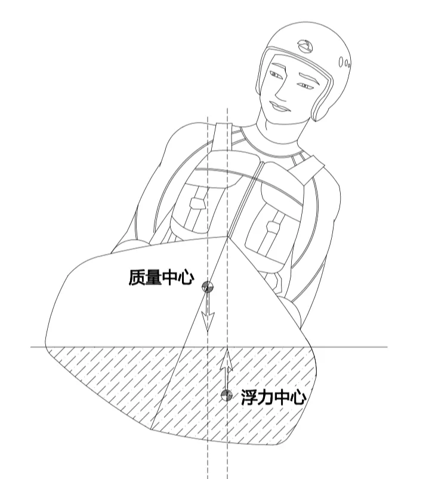

**图片 1-10：皮划艇的稳定状态，质量重心在内侧靠近中心线，浮力中心在外侧。推动皮划艇回归竖直。**

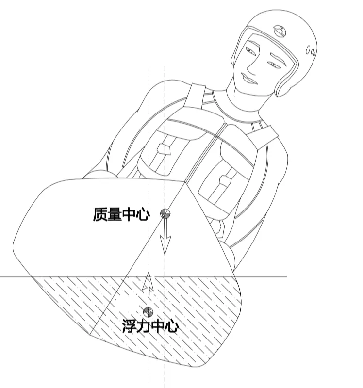

**图片 1-11：皮划艇的不稳定状态，质量重心在外侧远离中心线，浮力中心在内侧。重心的力量会加速皮划艇倾覆。**

### 船体宽度

从下图中可以看出，比较宽的形状更稳定，因为浮力中心 CB 向单侧移动的更快。在矩形船体中，底部迅速上升，使浮力从高侧移开，而另一侧下沉就可以弥补。当皮划艇的宽度发生变化时候。具有特定横截面的船随着变宽而变的更稳定。然而，正如爱斯基摩人几个世纪前发现的那样，最稳定的设计不一定是最好的，因为船体的形状也会影响到其他的方面。

### 降低重心

倾侧力矩的移动速度和质量中心的高度有关系，随着质量中心的降低，船的倾覆角度就会加大。这个质量中心是人在船上的重量和船的重量的总和。按照这个总和来看，皮划艇的重量主要就是人的重量。所以如果人站立在皮划艇上，稍微移动一点，就会到达我们理论计算上的倾覆点。就会倾覆，但是就像右图这样，仅仅下沉 1cm 就可以显著的提高船的稳定性。皮划艇通常有非常低的质量中心（cm） ，如果你坐在船底，你的质量中心 cm 也会下降。这样，一条比较窄的船也不会像大家想像的那么容易倾覆。我绘制的插图都是显示划艇的人笔直坐着。这个肯定不是划艇时候应该的坐姿，但是可以更好的描述我们所说的问题点。我们划艇的时候总是放松臀部，自然而然的调整位置在皮划艇浮力的中心上方。这个说起来很复杂，实际上就是人体的本能反应。就好像我们站立在平地的时候我们和地面是保持垂直的。但是我们在爬山的时候，肯定不会和山是垂直的，而是让自己重心在自己的脚下。这个是自然的行为不需要考虑。在皮划艇上是一样的，会很自然的保持平衡。在高性能的皮划艇中获得乐趣，很大程度来源于熟练的划桨技巧和轻松控制皮划艇的能力。当然每一种改进都是有代价的。高性能的皮划艇，比如奥运会比赛的 K1 艇，在艇上就不能放松，放松就可能发生翻船。

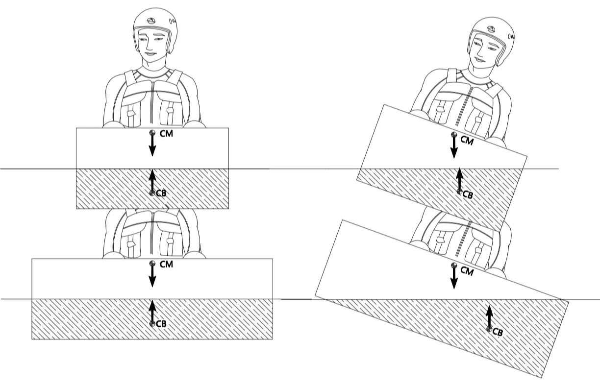

**图片 1-12： CM 为质量中心，CB 为浮力中心。图片中表示不同宽度的船体形状的扶正力矩变化，可以发现越宽的船体越难倾覆。也就是越稳定。**

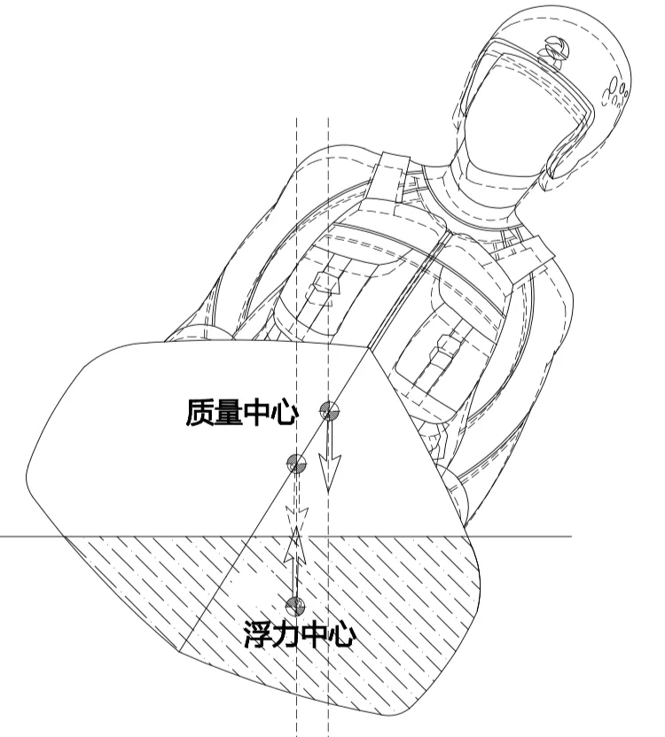

**图片 1-13：CM 为质量中心 CB 为浮力中心。这个图中黑色和灰色代表了座位高度的细微差别，当人员降低的时候，重心是低的。使船更稳定。在这个角度上， 黑色的位置会倾覆，但是灰色的位置会自然平衡。**

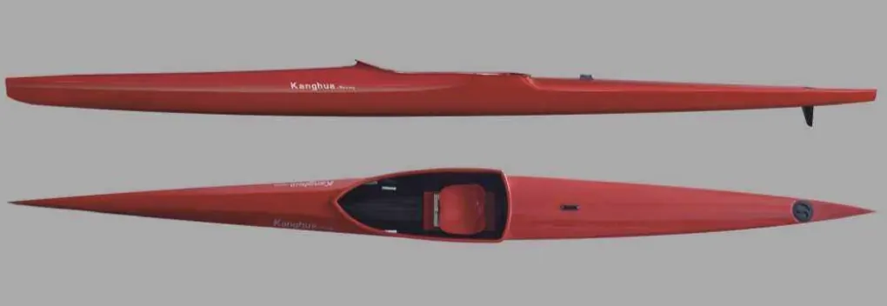

**图片 1-14：图片是奥运会比赛用艇，就是我们所说的 K1，这个艇是为了提高速度性能，牺牲了稳定性。**

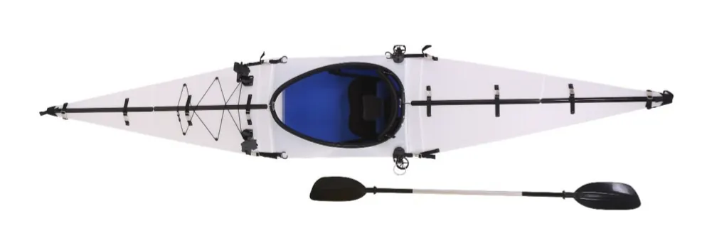

**图片 1-15：图片是澎逸折叠皮划艇，是为了提高稳定性，加宽了船体的宽度牺牲了速度。**

## 第三节：耐波性

船舶耐波性是船舶在波浪中运动特性的统称 , 它包括船舶在波浪中所产生的各种摇荡运动以及由这些运动引起的砰击、飞溅、上浪、失速甚至倾覆。皮划艇的耐波性和传统意义的船舶还是有很大的差异，毕竟皮划艇的体积非常小，我们只能借用耐波性这个名词来分析一下稳定性和耐波性之间的关系。具有很好稳定性的皮划艇，在海浪中反而不具备很好的耐波性。在海浪中让你保持直立的稳定性可能会使你在侧浪中直接倾覆。一般湖面的波浪，或者圆形的波浪不会存在这个问题。最多让皮划艇上下颠簸。在海上的大浪、白头浪，皮划艇滑动到浪尖的时候，很好的稳定性就是负担了。下图显示了两艘皮艇在波浪表面上的受力情况，图片中右侧皮划艇窄而尖，图片中左侧皮划艇宽而稳定。

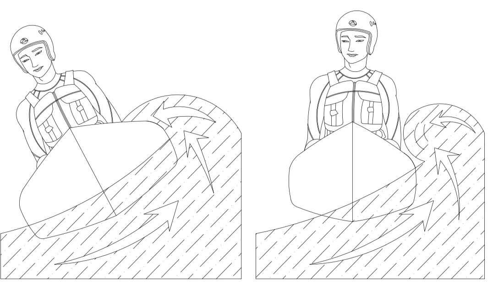

**图片 1-16：图显示了两艘皮艇在波浪表面上的受力情况，一艘窄而尖，另一艘宽而稳定。**

更宽船的稳定性创造了一个倾角的力量，致使皮划艇倾斜。这个时候皮划艇相对于竖直方向，这个倾角可能就会倾覆。这并不是因为船倾斜很多，是因为波浪的特性造成的。稳定的皮划艇一直是和水面垂直的，这样浪花的角度会直接让皮划艇超过倾覆角度，倾覆角度是和重力的夹角，和水面无关。我来解释一下，海浪中有几种力推动船。如图所示其中一个力使船向左加速，质量中心不能区分重力和加速度。波浪本身是倾斜的，因此向下的方向就是垂直于波浪表面的方向。致使船翻的是靠近波浪头部的水力量。波浪中水的翻滚旋转力量，就是图中箭头的指示的旋转力，使船不稳定。这个力是水在波浪内部运动，而不是外部波浪的形状。这个力可以把皮划艇翻过来。
面对这个海浪的翻滚力量，划艇人将皮划艇向波浪侧倾斜，可以让划艇底部接触面积更小，这样水的旋转产生的力量不以足以让皮划艇翻转。越窄的皮划艇艇就越容易让皮划艇向海浪来的方向倾斜。宽的划艇也是可以做到，但是会更慢更费力。

在暴风雨天气里，能够快速的倾斜皮划艇非常重要。这个是皮划艇的迎浪平衡能力，正是这种容易将皮划艇倾斜的能力，使不稳定的皮划艇在恶劣的环境下更安全、更舒适。不过这个需要一定的船桨技术技巧才能实现。有技术的人在风浪条件下可以一直保持稳定，没有技术的可能已经翻船了。

宽的皮划艇在海浪中反而没有窄的皮划艇耐波性好。这是和传统的船舶有所不同。其他和皮划艇类似的小船都会有相似的耐波性。

## 第四节：皮划艇的速度

即使你不参加皮划艇竞速比赛，速度仍然是一个需要考虑的重要因素。皮划艇的快速行驶能力是他的性能中很重要的一个参数。一个速度性能很好的皮划艇会更容易划桨前行，而且不会很快感觉到累。另外就是不参加比赛，有的时候遇到暴风雨，或者遇到水流湍急的时候，速度就关系到安全和效率了。

影响皮划艇的速度的因素很多，都是相互制约相互干扰的关系。比如说影响速度的长度因素，长度很长的船高速行驶的时候速度很快，效率很高。但是在不需要高速的时候却没有机动灵活的性能了。很难停靠，难以转向。这就是为什么选择合适你需求的设计才是最好的设计。大多数的人玩皮划艇是不想参加比赛的。旅行， 健身、观光游玩是第一诉求，但是他们也需要能够很长时间划桨而不感觉到累，还能可以放松的飘荡在水面上享受一下晨雾和夕阳。偶尔的时候也需要提高一下速度。

一般来说皮划艇越长，它能达到的速度越快，船身速度这个词也被定义为长度的参数。可以理解为船身的长度就是这个艇的最优速度，这个不是说皮划艇的速度不能比船身速度快。当达到这个速度的时候是皮划艇的最优状态。想要达到超过船身速度更快的速度，
会出现了消耗和速度不成正比。船身速度可以理解为消耗体能 1 个点，速度就能转化 1 个点。当超过船身速度时，体能消耗 2 个点，速度只能转化 1.1 个点。这个数据是为了更好理解的举例。不是实际测试的数据。实际上，船身速度是划艇时候的一个波浪的长度。皮划艇向前前进自身产生波浪时，速度可以让艇处于波浪的什么位置。

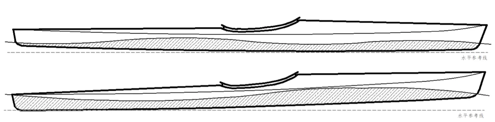

**图片 1-18: 上图为皮划艇的巡航速度，下图为皮划艇的船身速度移动产生的波浪。在其他条件相同的情况下，船越长速度越快。**

当一艘皮划艇穿过水面产生波浪，如上图所示，船移动的越快，两个波浪之间的距离越长。甚至可以达到两个波浪的距离就是船身的距离。当这个状态发生的时候，如上图中下侧图片，波浪从船头开始产生，波峰会在人体的前侧位置，波谷在船尾。本质上就是划船往波峰上走。这个会是很费力的。对于划艇的人来说达到船身速度已经非常厉害。当达到船身速度后，在用力划船也不会让皮划艇跑的更快，只会制造更大的波浪。换句话说，当皮划艇达到船身速度后，你的力量都会被用来造浪。

理论上来说，皮划艇可以超过船身速度。就和我列举的不恰当数据一样，那个时候力量转化比可能是你付出 2 的力量只能提高 1.1 的速度。快艇都是超过船身速度在跑，所以我们在快艇上会感觉到颠簸，那是超越快艇船头制造第一个浪到第二个浪跳跃滑行的颠簸。普通的人没有足够的动力让皮划艇保持这个状态，划一会就会筋疲力尽。

这里要说明一下，我们谈长度影响速度时，我们说的是水线长度，而不是总长度。毕竟皮划艇只有在水中的部分才会产生波浪。下图显示了格陵兰风格的皮划艇和阿留申风格的皮划艇对比。总长相同但是皮划艇的水线长度不同。从这点可以推断出，一条 5.2 米的悬挑很长的皮划艇船身速度将会低于一条 4.9米的船头和船尾几乎都是垂直的皮划艇。

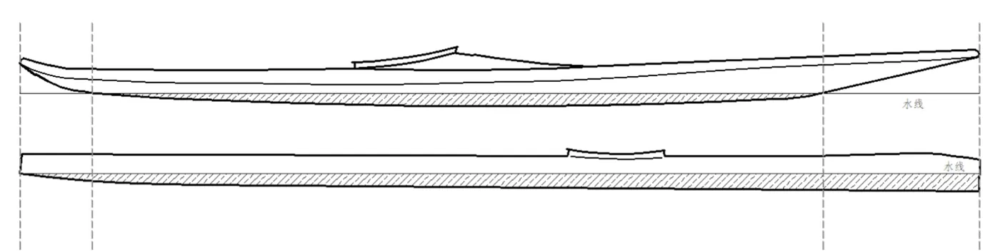

**图片 1-19: 格陵兰风格的皮划艇和阿留申风格的皮划艇的对比。总长相同但是皮划艇的水线长度不同。**

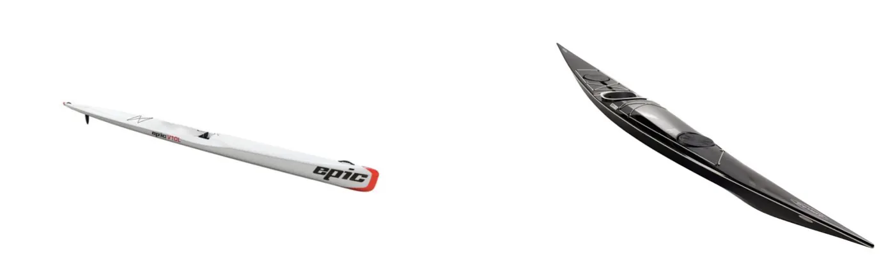

**图片 1-20: 这样我们可以了解为什么竞速比赛中经常看到阿留申风格的皮划艇，反而休闲旅游的时候大多的是格陵兰风格皮划艇，格陵兰风格皮划艇更倾向于技术、灵活性；阿留申风格皮划艇更倾向于速度。**

### 形状对于速度的影响

水线的长度本身并不能完全控制船的潜在速度，水线的形状也很重要。有的皮划艇有非常“精细”的切入口，就是说艇头部分从入水开始保持一段很流畅的狭窄形状，然后在逐渐的扩大到全船的宽度。一般来说船尾部分的形状和船头也类似。从整个船体宽度逐渐变细，变成一个流线型的出口。这个形状好像一个细长的梭子。当开始加速的时候。船体宽的位置把水排开，就形成了波浪。这样排开水后，实际形成一种尾部的水线部分没有起到作用。反而还降低了有效的水线长度。如果一条 5.2 米的皮划艇个你尾部水线很细，可能比 4.9
米的尾部水线偏粗的皮划艇的速度会慢。下图可以解释这个有效水线的问题

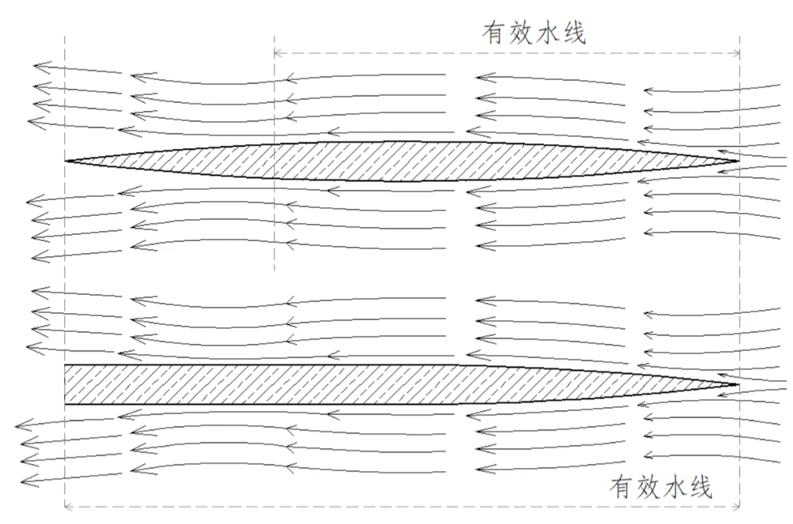

**图片 1-21: 图片显示尾部是矩形的水线有最大的船身速度，整个水线都是有效的。**

从上面这个图我们知道，尾部是矩形形状水线，整个水线都是有效的，有最大的船身速度。实际这个对于皮划艇不是最合理的。我们现代皮划艇没有这样的形状。大部分都快艇或者渔船有矩形的尾部，用来增加有效水线。当皮划艇在水中航行，船头的尖锐形状可以平滑的劈开前方的水面，然后沿着流线型的船体形状更顺滑的流动分开。当船划过后，水的重力和张力又促使水面回归原来的位置。矩形的截面在艇尾部会形成一个水的凹陷。分开的水没有那么快回归原位。这样艇头部和尾部就有一个压力差。同时水回归原位的时候还有一个吸力。两种力量一起作用在皮划艇上，拖慢皮划艇的前进速度。

合理的皮划艇水线造型是从皮划艇的头部分开水开始，水流会沿着船体形状慢慢加速向外一直到皮划艇的最宽位置，然后在平稳的减速回到水原来的位置。这样船体的阻力会减弱。这需要很好的头部和尾部形状。船体的形状起着导流的作用，影响通过时水浪的大小。流线体、表面光滑浪花会很小。

### 菱形系数

上面谈论从形态上理解艇头部形状和尾部形状的作用。但是如何精细设计，怎么能确定到非常精细的合理速度值？我们在船体设计上会采用一个菱形系数的术语。

菱形系数（prismatic coefficient），即棱形系数，两者意义一样，是指与基平面相平行的任一水线面下的船的型排水体积与对应的船长及中横剖面面积的乘积所表示的棱柱体体积之比。也等于船的方形系数与中横剖面系数之比。表示了排水量沿船长的分布，也表示了船的首尾部相对于中部的尖瘦程度。对船的快速性影响较大，对船的耐波性及建造工艺等也有影响。

这个菱形系数的概念来自于百度。也可以自己参考理解。我们通俗的来说一下这个概念，这是通过计算浸没在水里面的体积除以类似于棱柱的体积来确定水阻系数。

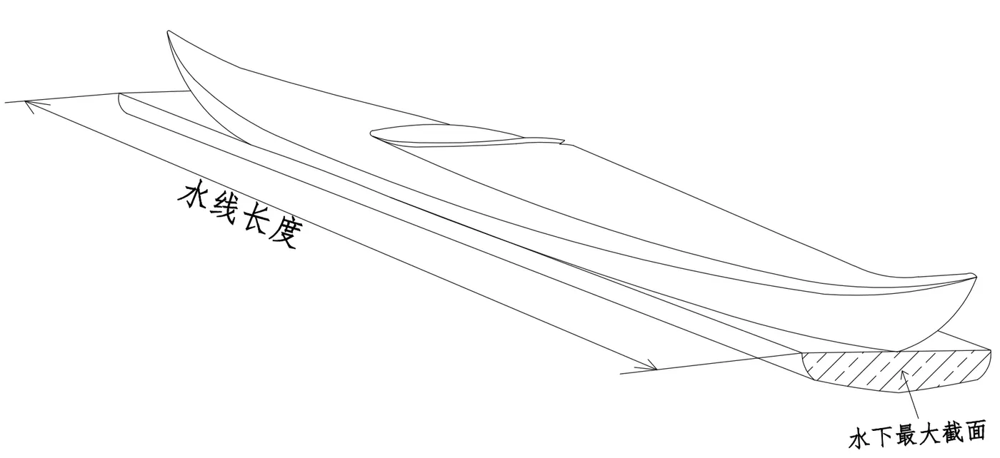

**图片 1-22: 菱形系数描述了船体的 “细度”。**

菱形系数描述了船体的 “细度”。计算方法是将船体的排水体积除以船体最宽截面面积与船体长度的乘积。一个很好的船体的菱形系数约为 0.45，而端部比较丰满的船的菱形系数是 0.6。 

我们来对比几个船型来解释一下菱形系数的作用。

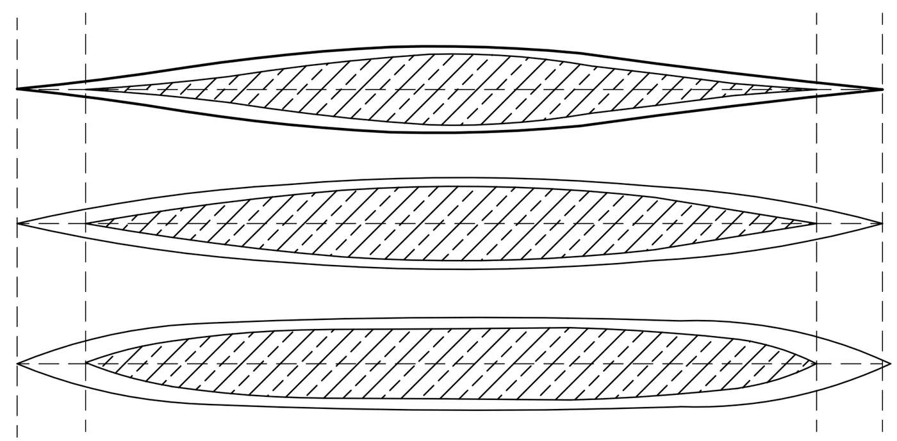

**图片 1-23: 不同的船型菱形系数对比图。**

图片中第一个皮划艇有很好的性能，比下面的皮划艇有较低的菱形系数。第二和第三号皮划艇形状有更高的速度，但是第一个皮划艇形状在低速的时候会更有效率。这样形成两个相互冲突的结构形状，一个是长度有效的水线，一个是良好的船体形状。怎么能达到平衡？最大船体速度只会在你试图尽可能快地划艇时和其他的皮划艇产生差异。大多数时候，你可能会在低于船体速度的情况下放松旅行休闲，毕竟皮划艇比赛的时候还是少，船体形状的效率将决定船只移动的容易程度。因此，我们不会使用一个极端的追求速度的设计。也不希望完全牺牲掉操控的灵活性。这样第二个船型就是一个折中的设计。有低速的操控，还有可以接受的最高速度。

水线的形状也会影响速度。第一个船体在船头和船尾的水线处有一个明显的凹陷。这样可以平稳的加速入水和排开船身周围的水，但是会缩短水线的有效长度。降低船身的速度。最下面的船体最大限度的利用了它的长度，将有一个更高的船体速度，但是将会需要更多的力量来达到这个速度。在较低的速度下划水前进也会更困难。中间的船体是一个折中，可以提供低速的效率和令人满意的最高速度。
回头我们在看看格陵兰艇和阿留申艇。这两个基础的船型，代表的就是两个方向。技术流和速度流。

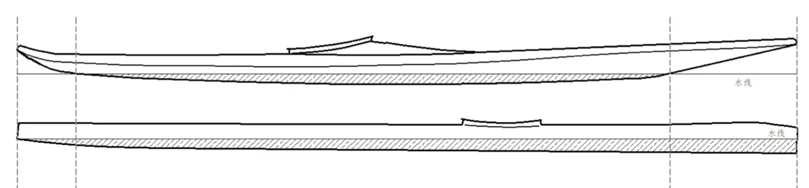

**图片 1-24: 技术流的格陵兰皮划艇和速度流的阿留申皮划艇**

理解了形状对于速度的影响，知道了格陵兰风格和阿留申风格皮划艇差别，就可以理解当前中国皮划艇的两种分化状态。比赛的兴起，使阿留申艇风格的皮划艇大放异彩。形成了职业队的风范。用格陵兰皮划艇和阿留申皮划艇两类一起比赛。不用想也知道结果。这样痴迷于格陵兰的旅行技术流派，和痴迷于速度的竞技流派就有了两级分化。

## 第五节：操控性和循迹性

皮划艇使用过程中，有两个重要的因素，可操控性和循迹性。在划艇过程中可能会遇到很多意外的状况。例如你在近岸水域划艇，突然侧面来了一个大浪。这个时候要么你会被大浪冲到岸边， 要么你就要调转船头，迎着浪冲过去。这个时候就需要皮划艇具有很好的操控性。操控性就是能更好的控制皮划艇快速转向的能力。

划艇的时候可能遇到大风，风从一侧吹过来。你还要保证皮划艇的前进，不可能把全部的精力都用来控制皮划艇的方向。这样就需要皮划艇本身具有很好的保持直线航行能力，专业名字就是皮划艇的循迹性。

一般来说船越短，操控起来更容易。皮划艇越长它的循迹性越好。这两个概念之所以一起来说，也是相互制约，相互平衡的两个设计参数。大多数人肯定想要一艘操控性好同时循迹性也好的皮划艇，这也是可能的。找到最佳的平衡点即可。

如果以我们人体为中心，控制皮划艇转向是以船桨为作用力，最大的阻力来自皮划艇的末端，就是船头和船尾的水阻。如果船头和船尾一直处于入水深度比较浅的状态，可操控性就会大大提高。这个就是皮划艇的龙骨弯曲度。这个弯曲度不是一个精准的术语。可以通俗理解为一艘龙骨弯曲度大的船（龙骨在两端急剧向上弯曲）比一艘有直龙骨的船在相同水线长度下，弯曲度大的船更容易转向。这个参数可以更好的解释为什么我们会定义格陵兰纽因特皮划艇为技术流派的皮划艇。它的操控性，转向能力，和灵活性比阿留申皮划艇强的非常多。根据船型特点，甚至可以不严谨的推断出格陵兰的因纽特人他们生活的环境更趋向于近距离捕猎，经常进入很多狭小的范围，需要有很高的灵活性和对于划艇人更高的技术要求。而阿留申人他们更倾向于长途围猎，在很广阔的区域内来捕获大的猎物来生活。这是根据实用性的表现特征来反推的。也可以阐述两种皮划艇的区别。

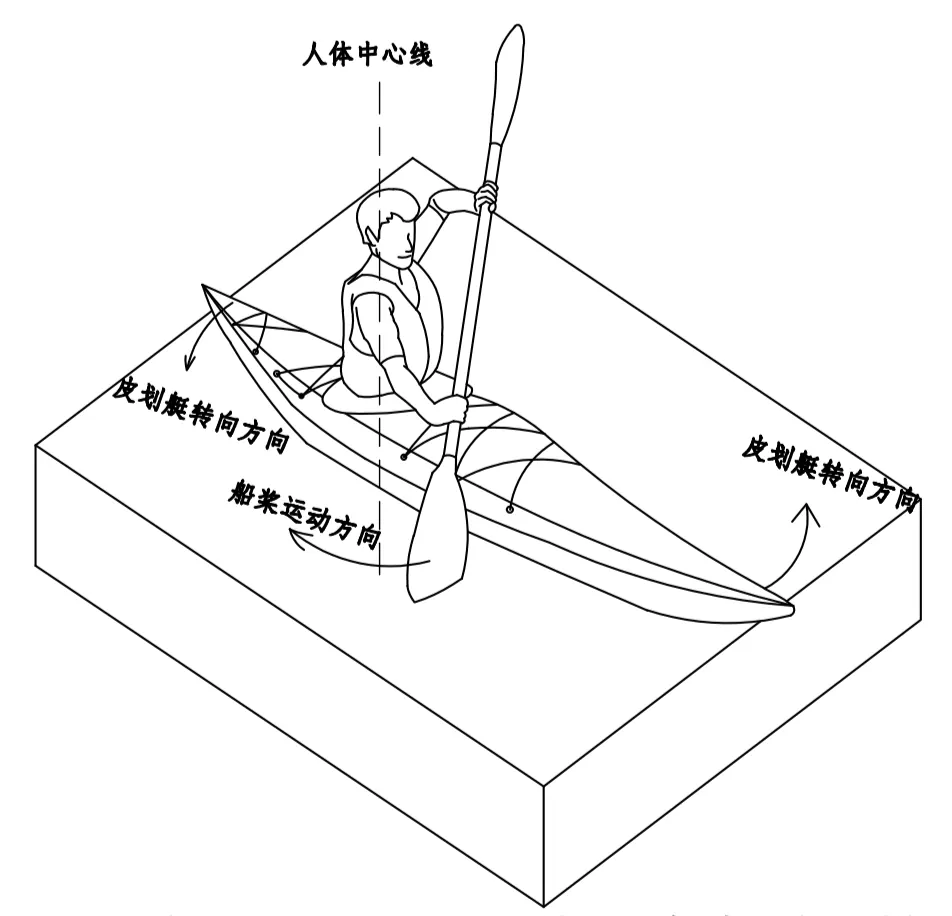

**图片 1-25: 从上图可以基本了解皮划艇的操控性。划桨人通过划桨使皮划艇转向，是以人体为中心，叶片入水反作用力的一个力矩，最大的水阻来自船头和船尾部。这样船头和船尾的形状会很大程度影响操控性。**

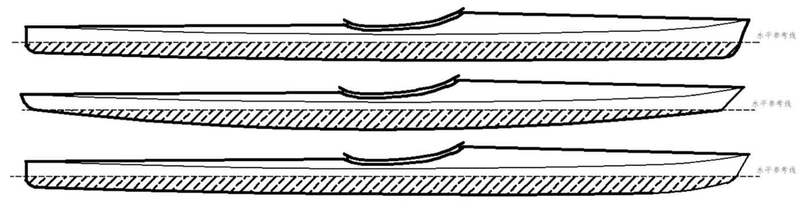

**图片 1-26:三艘不同的龙骨弯曲的船身，最上面的船体的龙骨几乎是直的，没有龙骨弯曲。中间的船体有许多的弯曲，在船的头尾不减少了水的阻力。最下面的船体是一个平衡的设计。**

图片上展示三艘不同龙骨弯曲的船身，最上面皮划艇龙骨几乎是直的，没有龙骨弯曲。中间的皮划艇船头和船尾龙骨都有弯曲，在艇的头尾部减少了水的阻力。最下面的皮划艇是一个平衡的设计，艇头位置增加了龙骨的弯曲度，可以增加操控性，而尾部没有弯曲度，可以增加循迹性。为了清晰的表达，图片上都是被夸大的描述，不是实际皮划艇的形状。

一艘循迹性良好的船不容易被风或者浪推离航线。但是良好的循迹性取决于船体在水面上和水下的形状和面积。如果整条船都暴露在相同的天气条件下，船头一侧的风也会推动船尾。两端不同的形状也会产生不同的力，但是这些力可以通过船体在水中的形状来平衡。理论上，船头对侧推的阻力应该与船尾对侧推的阻力相平衡。实际上，你希望船尾不那么容易被推动。可以使用方向舵和斜鳍来完成，也可以用船尾比船头更少的龙骨弯曲度来完成。这就是上图中第三款船所使用的平衡设计原理。

## 第六节：体积和内部尺寸

皮划艇越大你带的东西越多。在现实情况下，即使是长途旅行你也不需要那么大的空间。背包客会把他们需要的东西都背在背上。即使最小的海上皮划艇也比背包的空间大了很多。大多数的皮划艇都超过了你需要的体积。即使你没有更有效的打包，也不需要太大的体积。我们会把其他的考虑因素放在第一位。如果你想携带更多的装备，你需要一艘更长或者更宽的船。很多自称“高容量”的设计，也不能告诉你多少承载能力的信息。如果高容量的设计正好是位于船头舱部，皮划艇很可能在波浪中被抬起。船首的体积越大，遇到波浪时浮力越大。

关于体积和内部尺寸的因素是我们需要考虑的因素，但也不需要太在意。需要注意的是划艇的人的身高体重不同，更舒服的舱口尺寸是需要注意的因素。更合适的舱口尺寸可以更方便上下艇。太大的舱口会积水，太小的舱口不容易上下艇。

## 第七节：选择你合适的皮划艇

前面我们用了六个小节来讲解皮划艇性能中的各个因素。现在总结一下如何选择一条正确的皮划艇。选择一艘正确的皮划艇的第一步是需要知道你为什么想要它，打算用它来做什么。你计划去哪里划艇。如果你住在宽阔的海边，你的需求肯定和住在小池塘附近的朋友不一样。如果你已经划过皮划艇了。这个决定会比较容易。如果你不是专家。你就需要做一个清单，写上你想用这个皮划艇做什么。这个清单可以帮助你决定哪些特性比较重要。你需要什么样子的皮划艇。可以在现有的皮划艇类型中选择， 也可以根据实际需求来自己设计，自己制作。这个清单也可以帮助你确定你的皮划艇，主要倾向于什么性能。

你需要速度比较快的皮划艇，可以很好的完成长时间的远洋航行。探索小湖是就需要轻量级的易于操作的皮划艇。如果是穿越沼泽地也需要很好的机动性能。拍照或者钓鱼在一个稳定的平台上会更容易。这样你就需要更大的体积。为了露营旅行或者旅行冲浪你需要一个轻量级的皮划艇。你需求的可能性几乎是无限的。但是以下是一些可以帮助你选择最合适皮划艇的注意事项。

### 目标是一个大湖或者大海。
你需要一个比一般人更大一点的皮划艇，一艘稍微大点的皮划艇通常在大水域的条件下表现的很好。

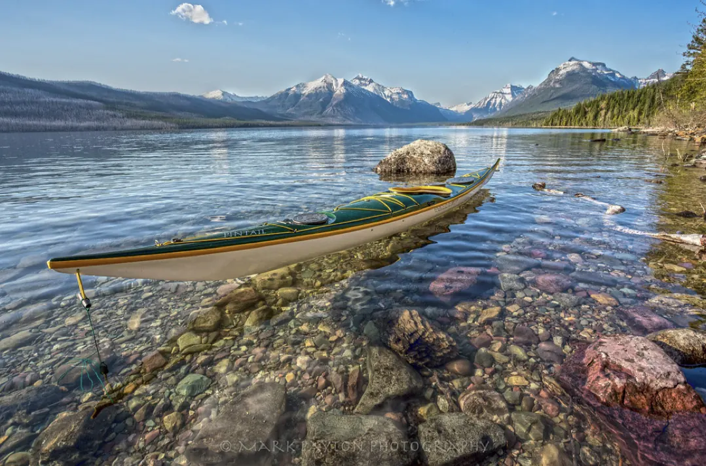

### 目标是小池塘、河流和湖泊。
通常情况下你需要一个小的皮划艇，这样才能更容易的进入哪些很漂亮的狭小地方。同时水域之间的切换，小皮划艇也更容易。

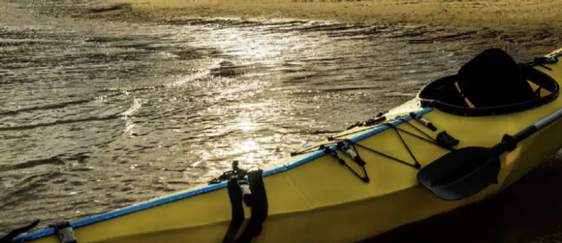

### 目标是冲浪。
一个更窄的不太稳定的皮划艇在风浪的环境中会更好，更有乐趣，也能更好的处理波浪的环境。

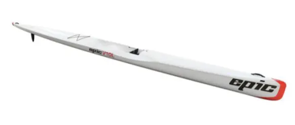

### 目标是平静的水面。
几乎没有波浪的给你推倒。你就可以坐下来放松一下，不用担心翻船，你就选择一个更宽的皮划艇，更小的皮划艇会更容易操作同时也更容易携带。

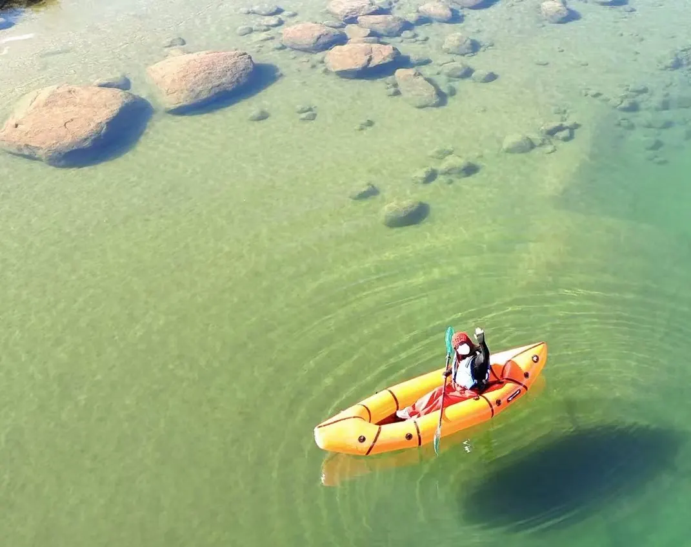

### 公开水域。
你需要一艘低调、快速、不大招风的皮划艇。如果你想让你快速的摆脱麻烦。你就需要更长更窄的皮划艇。

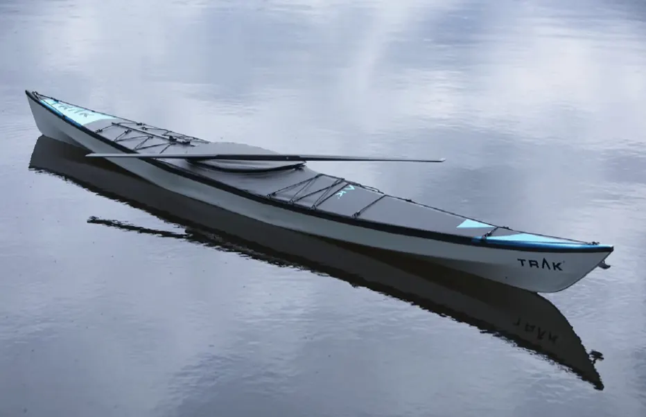

### 长途旅行。
找一艘快速高效的皮划艇。如果你要划一整天的水，你需要用最小的力气，不可能全速划水。你需要一艘能够轻松达到真正快速的皮划艇，而不是一艘需要付出很多的努力达到最高潜在速度的皮划艇。你的航行应该是中等长度，很窄，循迹性很好的皮划艇。

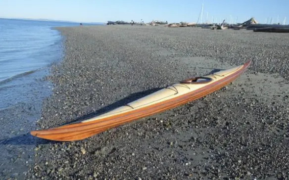

### 狭窄、蜿蜒的水道。
一艘很短的，可操纵的皮划艇在狭窄的水域中表现最好。在狭窄、曲折的河流和通道中航行时，它将是快速有效的。

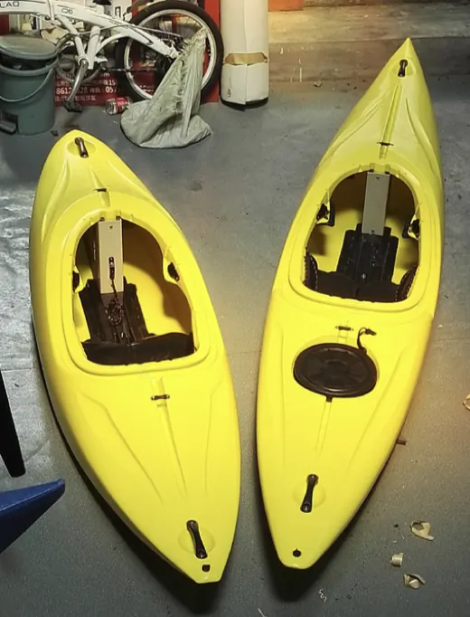

### 野营旅行。
你需要额外的排水量来携带大量的装备。与其说是一条长皮划艇，不如说是一条宽皮划艇。宽的皮划艇一般更有效率。但不要太长。最高速度不是那么重要。增加货物的重量也需要一艘更坚固的皮划艇，稳定性不是一个大问题，因为装备的重量有助于稳定。

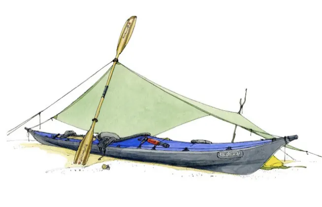

### 短途旅行。
短途旅行不会像长途旅行那样让你感到疲劳，所以效率低一点也能带给你其他的好处，你的皮划艇可以更宽更稳定。如果你只是出去玩，良好的机动性将会大大的增加你的乐趣。

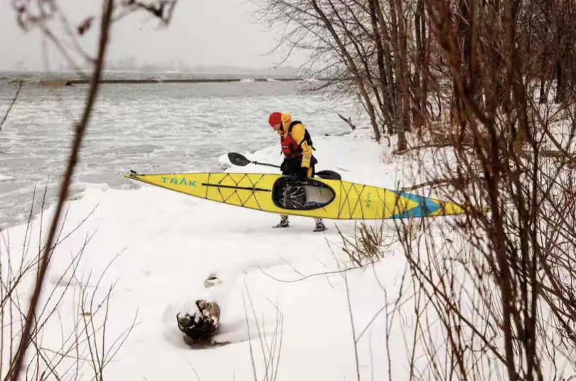

### 为了比赛。
在这里你需要全速前进，你的船需要轻、窄、最小的湿表面积。皮划艇太长只会增加不必要的入水表面积和重量。计算出你要多快你才能赢，然后围绕这个速度来设计你的皮划艇，这种情况你可牺牲强度来减轻重量。

### 为了探索。
因为你永远不知道你可能遇到什么情况，你需要一个通用的皮划艇，具有良好的机动性和良好的速度。一艘具有龙骨弯曲的中等长度的皮划艇应该很好用。

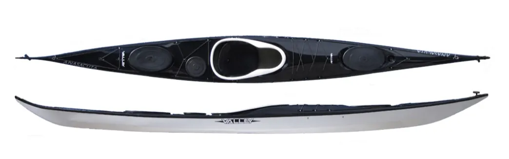

### 在布满岩石的水域。
给自己找一条足够坚固的可以灵活操控的皮划艇，它会在你途中的岩石周围转弯。你需要比平时更重要的平台

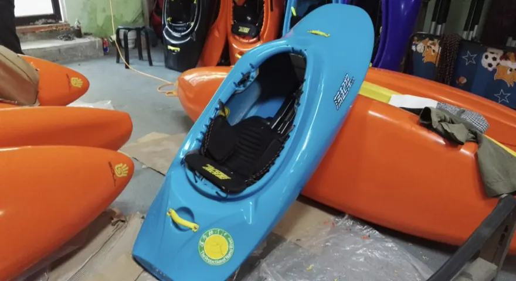

### 在沙质或者泥泞的水域。
与一堆泥土或者软沙相撞可能会造成混乱，但是不会对你的皮划艇造成太大的损害。你的皮划艇需要造的比一般的皮划艇更轻盈一点。

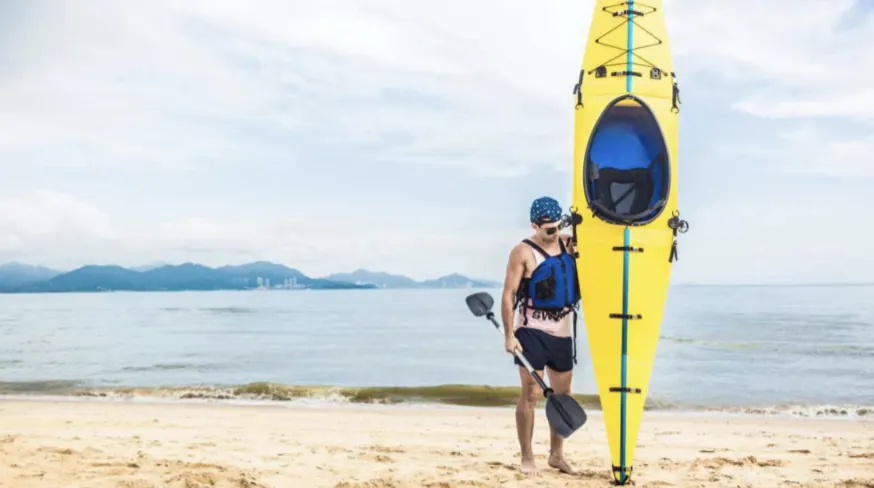

要记住，你不会找到一个合适所有环境的皮划艇。皮划艇是多功能的船。如果你为了一个目标选择了针对这个目标的最好设计，你仍然可以在不同的条件下使用它。你不用走极端选择你需要的皮划艇。要做一些权衡，比如机动性能和速度。

现在，在提供了所有上述关于不同设计的不同性能信息后，不要被细节困扰。让我重复一遍我的想法：皮划艇是多用途的工艺品。你会喜欢上你所做的任何设计，一个最初为湖泊设计的皮划艇可以在开阔的水域安全使用，前提是需要保持你划艇的技术。要是你觉得你当前的皮划艇有问题，同时你有很好的解决方案，那么你可以在造一条皮划艇。

---

> **转载声明**：本文转载自吴树升《艺术级皮划艇建造技术》（[原文 gitee 仓库](https://gitee.com/feathercraft/how-to-hand-build-a-kayak)），
> 经作者授权以 **CC BY-SA 4.0** 许可公开，转载请署名并以相同方式共享。收录台账见本站 RIGHTS 台账（rights: cc）。
