# 第二章 型线图的绘制原理与识图

解析针对皮划艇的设计加工中的型线图的绘制原理，绘制方法、基本构成以及根据型线图来绘制皮划艇的实物形板模具。

## 第一节 概述

皮划艇、独木舟、桨板以及各类船舶甚至到游艇，所有的外形形态都是一种复杂的、近似于平顺的曲面状态。为了使船舶具有很好的水上性能，船体外表面都是一个具有纵向和横向双重曲度的光滑曲面。如果用机械制图中的表达方法，将船体的外部形状分别投影到正投影面、水平面和侧平面，得到的三个视图只能表达船体外形的最大轮廓，并未完整地表达出船体的准确形状。那么船体的形状是如何表达的呢？目前，表达船体形状最常用的的方法就是图示法。即用船体型线图来描述船体的形状特征。型线图是采用标高投影法绘制的，它不仅表示船体的形状和大小，而且还是船舶设计时计算各种技术性能，绘制其他图样及船体放样工作的依据。

我们这个部分讲解分为两个大部分，第一部分是型线图的绘制原理，第二部分是如何根据型线图来绘制我们需要的部件，进行皮划艇或者独木舟以及桨板的制作。

## 第二节 型线图的三视图

在看型线图的时候，其根本依据还是国标机械制图的基本原理。还是存在三个基本的相互垂直的面。下图就是皮划艇的三视图

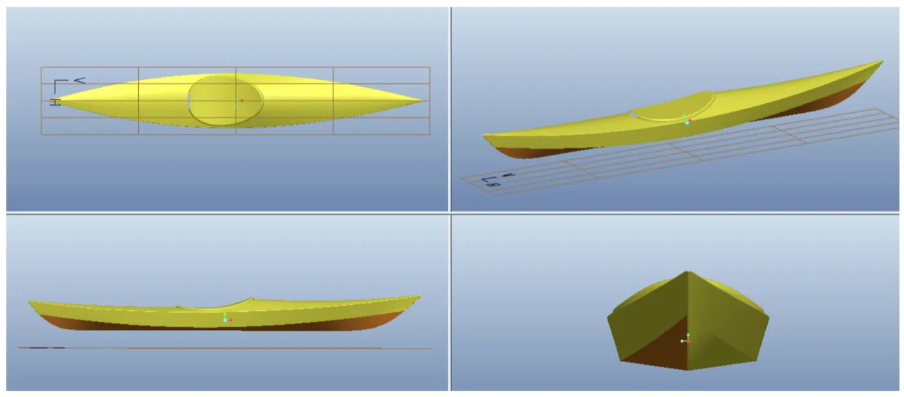

**图片 2-1: 皮划艇的三视图**

三视图中可以看出这个皮划艇的形式和结构，但是没有办法展示出来皮划艇表面的曲线结构构成。这样就需要延伸出来另外一种方式，就是型线图。型线图的构成和机械制图一样，同样有三个相互垂直的基本面。

### 1. 中纵剖面（平行 V 面）
将皮划艇从船长方向垂直分为左右两个部分的垂直平面称为中线面。中线剖面剖切皮划艇后形成的剖面是中纵剖面。这样可以清晰的表达了龙骨形状，皮划艇头部和尾部的外形轮廓线。
图片中将皮划艇从船长方向垂直分为左右两个部分的垂直平面称为中线面

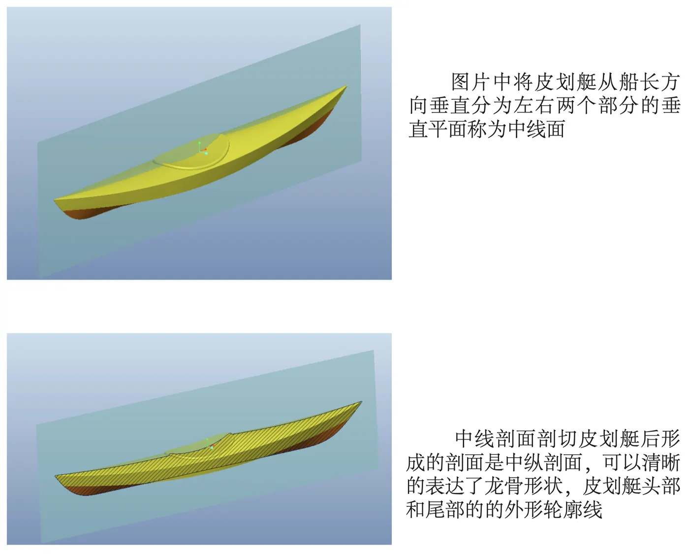

### 2. 设计水线面（平行 H 面）
通过皮划艇的设计水线所做的一个平面称为设计水线的平面，这个平面把皮划艇分为上下两个部分。可能说我们在设计的时候也不知道这个水线在什么位置，这个没关系，你可以用任何位置作为这个平面，就是和船体水平方向必须平行即可。

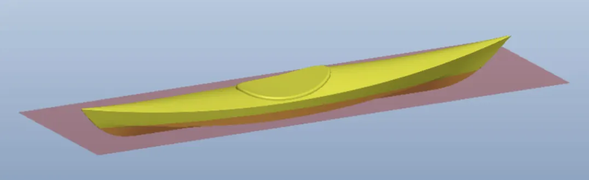

**图片 2-4: 设计水线平面示意图（平面位置高度方向上可以任意调节）**

### 3. 中横剖面（水平 W 面）

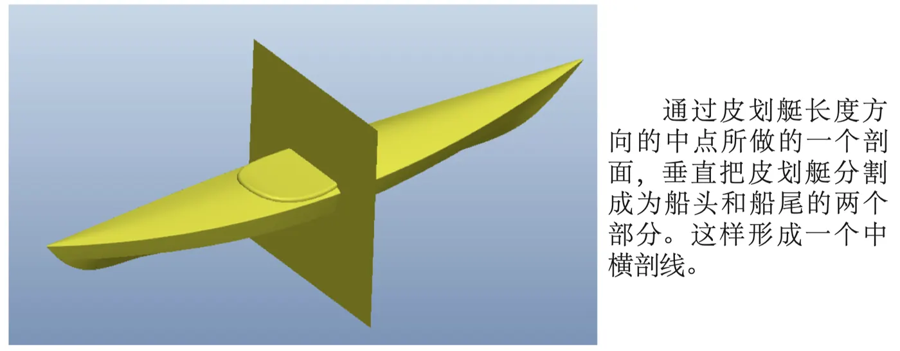

这样我们就有了三个相互垂直的平面，皮划艇的任意位置都可以通过这三个平面来找到了。
中线面，设计水线面，中站面这三个剖切平面是相互垂直的，他们之间的关系可以看下图理解。根据平面投影为直线的原理，这样就形成了三条相互垂直的直线，在三视图的任意一个视图都有一个相互垂直的直线。

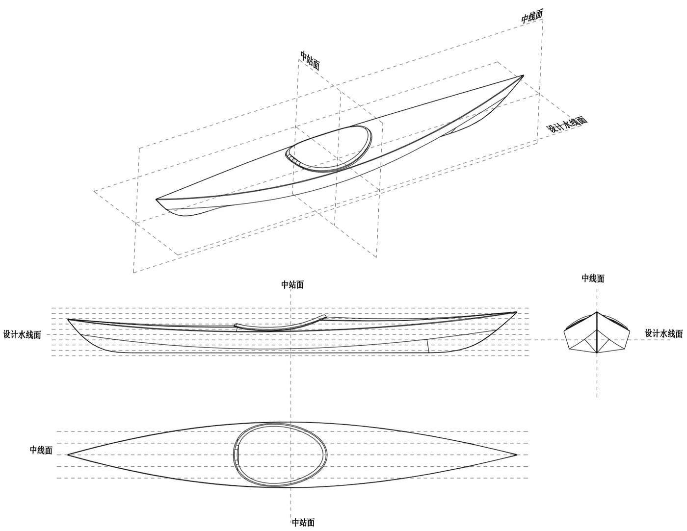

## 第三节：型线图的线条投影

从上节图中我们可以看到，三个平面的关系和在皮划艇中的位置，三视图没有办法标识清晰皮划艇表面的曲面数据和结构，只能显示出龙骨的形状，长短等基本尺寸。那么曲面是怎么表达的哪？三组截交线的投影

### 1）纵剖面和纵剖线。

平行于中线面的各个纵向平面剖切船体后所形成的剖面称为纵剖面。纵向平面和船体相交的线是纵剖析线，纵剖面和中线面平行，根据船宽和精度要求一般 2-4 根。可以选择平分半个船体宽度，也可以固定数值偏移中线面。主要是反映船体宽度方面上的各个曲面的变化

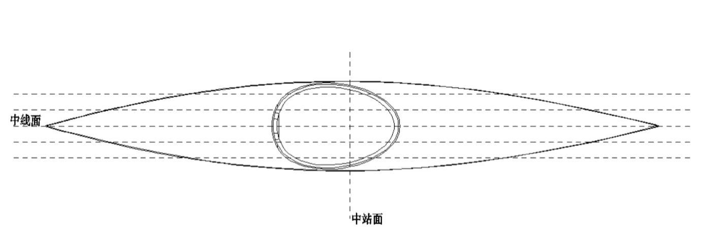

由于皮划艇大部分都是左右对称设计，所以我们可以用实体图纸来分解开这个纵剖面和纵剖线如下图。

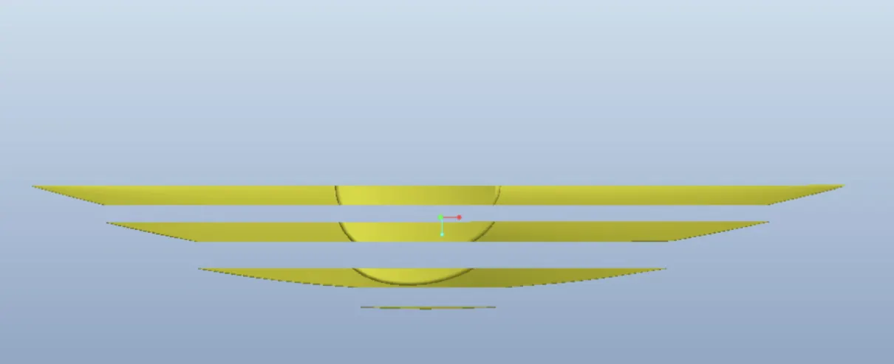

每个纵剖面上的纵剖线投影到中线面上后形成了型线图的一个侧视图

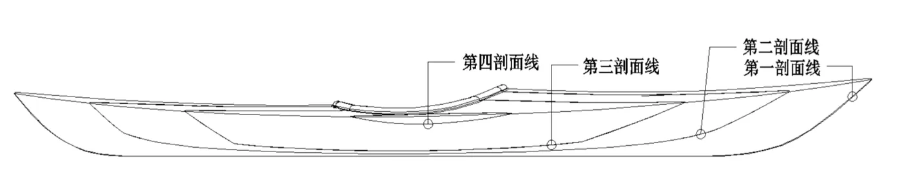

**图片 2-10: 型线图侧视图**

型线图侧视图，通过纵剖面上的纵剖线投影到中线面所显示的各个截面展示，来表示皮划艇在宽度方向上的曲面变化。

### 2）横剖面和横剖线

平行于中站面的各个横向平面剖切船体后形成的剖面是横剖面，横向平面和皮划艇相交产生的线条就是横剖线。皮划艇的船体是两侧对称的。在画图的时候为了表示清晰，一般规定从最大轮廓线开始到船头的位置放在左边，最大轮廓线到船尾的横剖线放在左边。这样可以更清晰的看出来线条的差别。

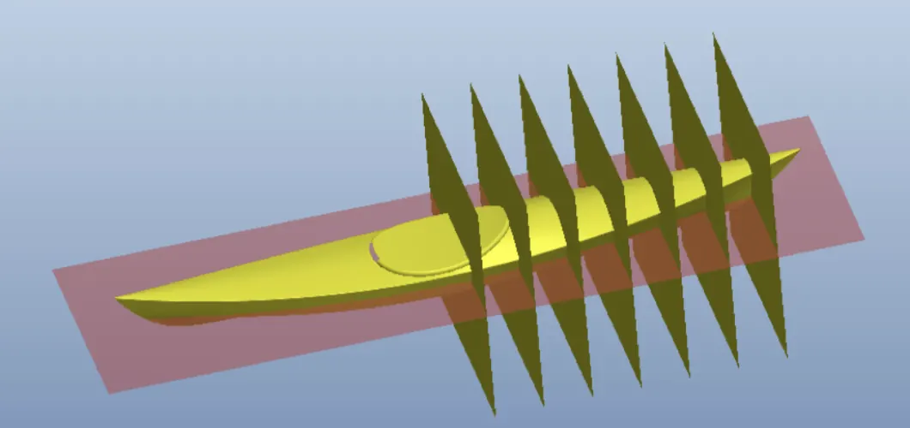

把所有的横剖线投影到中站面，就形成了皮划艇的型线图中的主视图。由于皮划艇纵向长度比较长，等距离的剖面数量比较多，船头一侧按照国标标准放在右侧，船尾部分的剖线放在左侧，形成了下图。

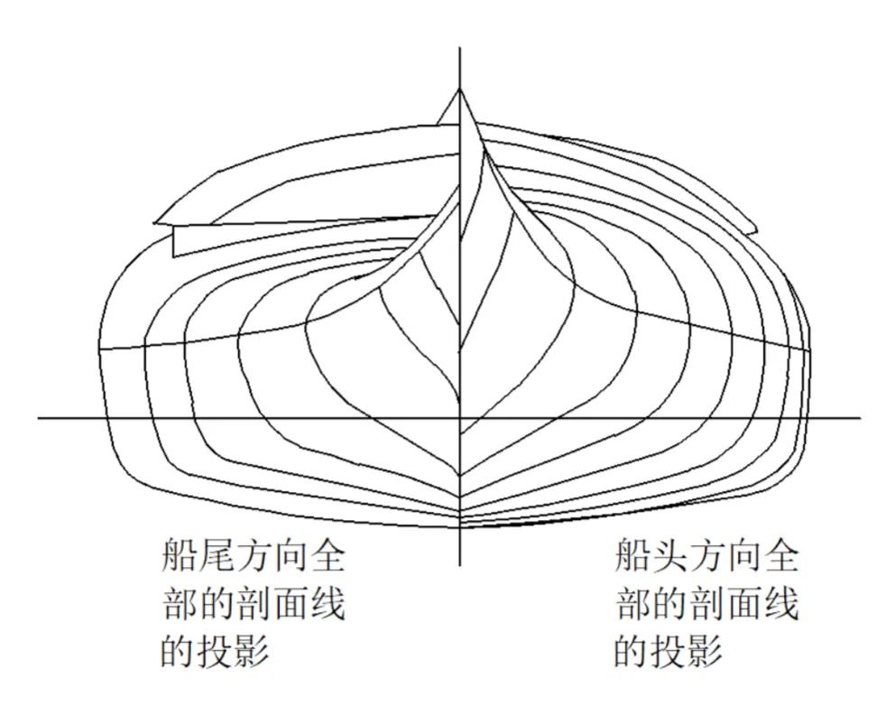

**图片 2-12: 皮划艇型线图的主视图**

从这里可以看出！我们制作皮划艇的时候每个模板就是做出来横剖面。下图可以看到皮划艇的制作过程中的剖面的使用情况。

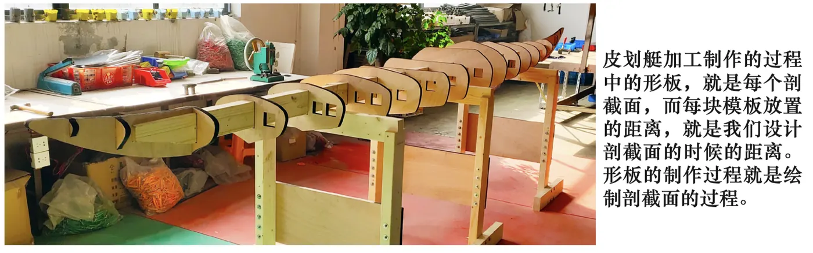

### 3）水线面和水线

水线面和前两个一样，也是平行于水线面的各个剖线所组成的。分层切割皮划艇船体，和每个截面都形成一个交点，而这个交点就是皮划艇表面的形状数据。

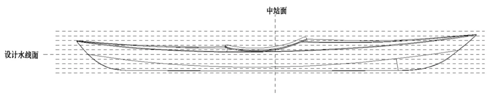

下图就是皮划艇型线图的俯视图，是由各个水线面的剖面投影叠加而成。

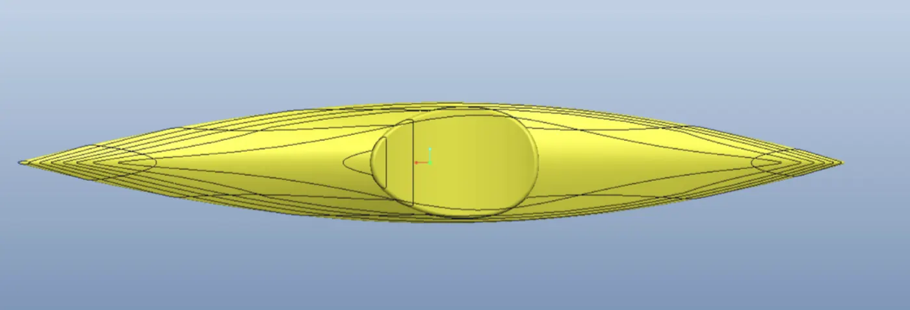

## 第四节：纵剖线、横剖线、水线编号及型线标注

为了便于绘图、识读和使用型线图，型线图上的型线需要编号和标注

### 1. 纵剖线的编号和标注
纵剖线的编号方法是：以纵剖线距中心线的距离（毫米数）作为编号，例如距离纵剖线中心线面的距离是 50 毫米，则该纵剖线编号就是 50 号纵剖线，其余以此类推。

纵剖线编号的标注：纵剖线在半宽水线图中标注在格子线的首、尾两端；在横剖线图中标注在基线下方；在纵剖线图中标注在纵剖线的首尾部分，编号沿着型线写在型线的上方，字体与型线尽可能垂直，中剖线在视图中不加标注。
中纵剖线在 H 面和 W 面上的投影，称船体中线。

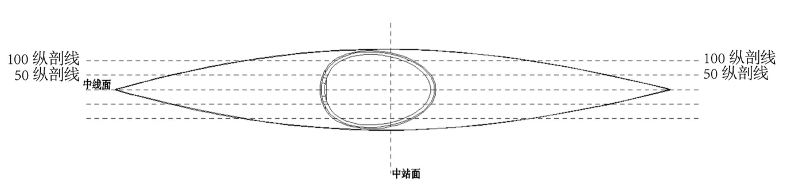

**图片 2-16: 在纵剖线图中标注在纵剖线的首尾部分**

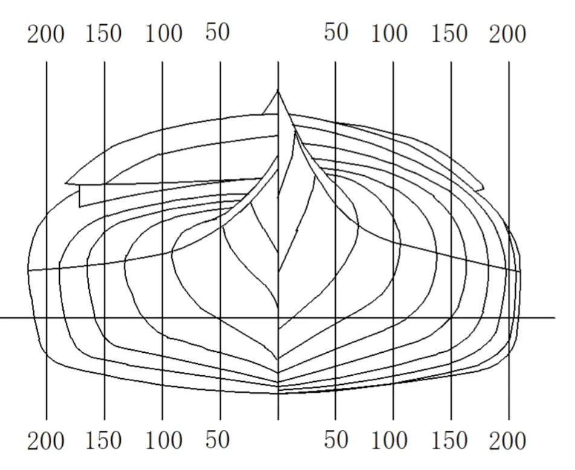

**图片 2-17: 在半宽水线图中标注在格子线的首、尾两端**

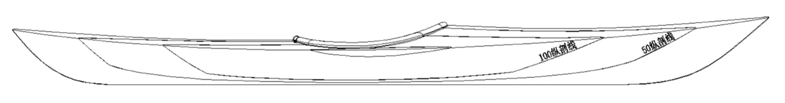

**图片 2-18: 纵剖线图中标注在纵剖线的首尾部分，编号沿着型线写在型线的上方，字体与型线尽可能垂直**

### 2. 横剖线的编号和标注
横剖线的编号方法是：从尾垂线至首垂线依次用 1,2,3.... 等数字编号。在首、尾端添加截面的时候用 1/2 站或者 1/4 站标注以及最后一个编号的位置添加 20- 1/2 站 20-1/4 站编号表示。

横剖线的标注：横剖线在纵剖图中标注在基线下方；在半宽水线图中标注在船体中线下方；在横剖线图中标注在横剖线上方，字体尽量和型线垂直排列在一条线上。

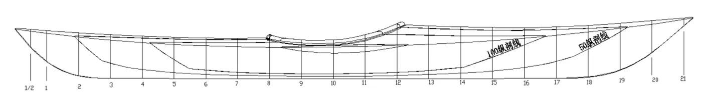

### 3. 水线的编号和标注
水线的编号方法是：以水线距基准平面的距离（毫米数）作为编号。例如水线距离基准平面是 50mm 这个水线编号就是 50W/L，其余类推。

水线编号的标注：水线在纵剖线图和横剖线图中标注在格子外侧对应的水线上方。如果横剖线图重叠布置在纵剖线图中，则横剖线图不需要标注水线编号，在半宽水线图中，水线标注在水线的首尾部分，编号沿着型线，写在型线上方，字体尽量与型线垂直。

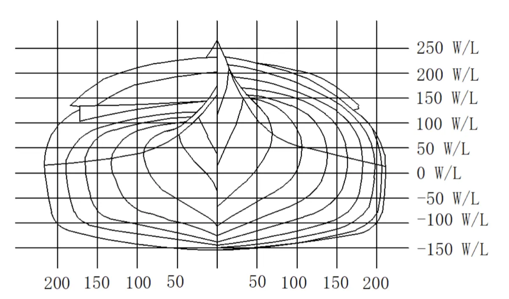

### 4. 其他曲线的标注

甲板中线、甲板边线，最大外形线在图中可以用对应的文字标注在型线的上方，字体尽量与曲线垂直。特别注意皮划艇的型线图和传统国标的型线图还是有所差别，需要区分甲板和船底，有一条最大外形线我定义为分型线英文标识为 P/L，代表皮划艇甲板和皮划艇底壳的结合线。在型值表中也有单独的一栏用于表明 P/L 点的型值。另外还包含了艇头和艇尾龙骨形状的型值表，一套座舱的尺寸型值表，有的皮划艇为了支撑座舱外圈还有一个支撑板型值表。为了标识清晰，一套完整皮划艇图纸，包含三页。第一页为皮划艇型线图；第二页为甲板和船体的型值表；第三页为附件的型值表。（参见下页澎逸海王子图纸范例。）

### 5. 视图中可以直接标注的尺寸

型线图中，有些尺寸如果由型值表提供是很不方便的。例如皮划艇头部轮廓线尺寸，皮划艇底部的斜升尺寸，可以直接标注在视图中。（参见下页澎逸海王子图纸范例。）

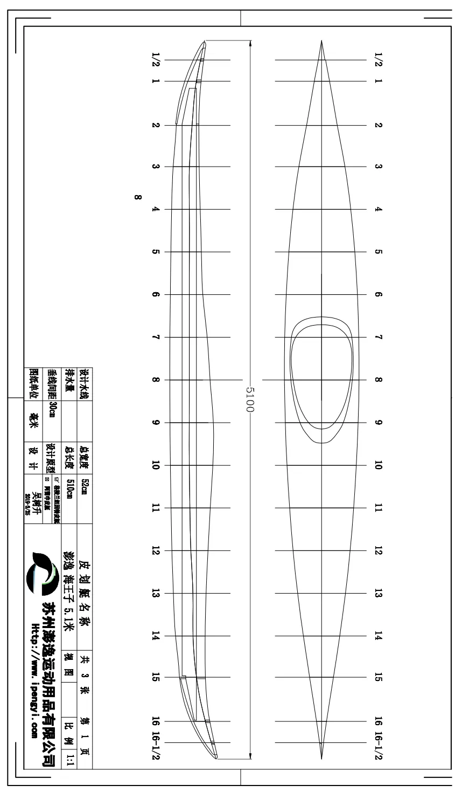

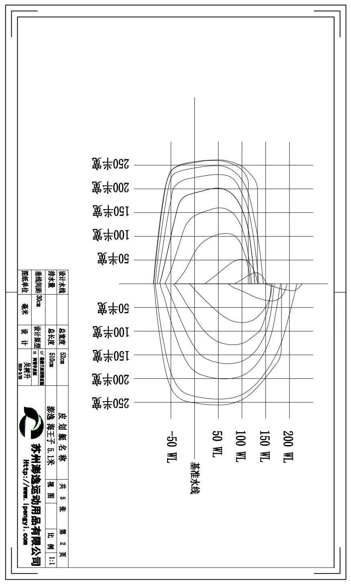

## 第五节：识读型线图
皮划艇的型线图的读识主要是了解皮划艇的大小，外形形状，并且根据三组截交线来了解皮划艇的型线沿着长度方向，宽度方向和深度方向的变化。现在以下页的图纸为例子，说明一下型线图的识读方法和步骤。

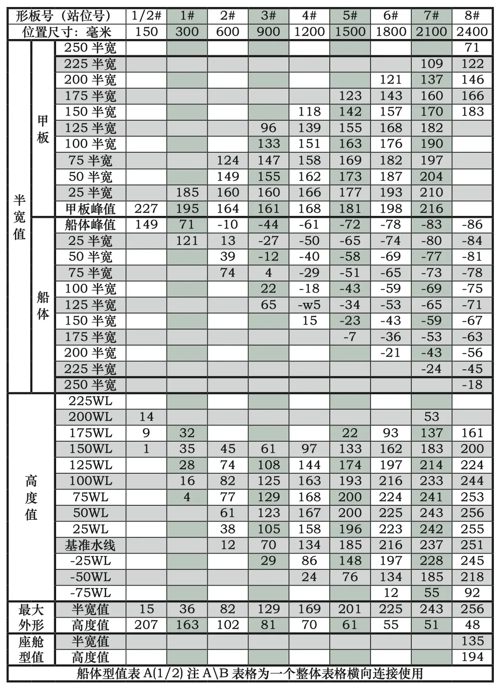

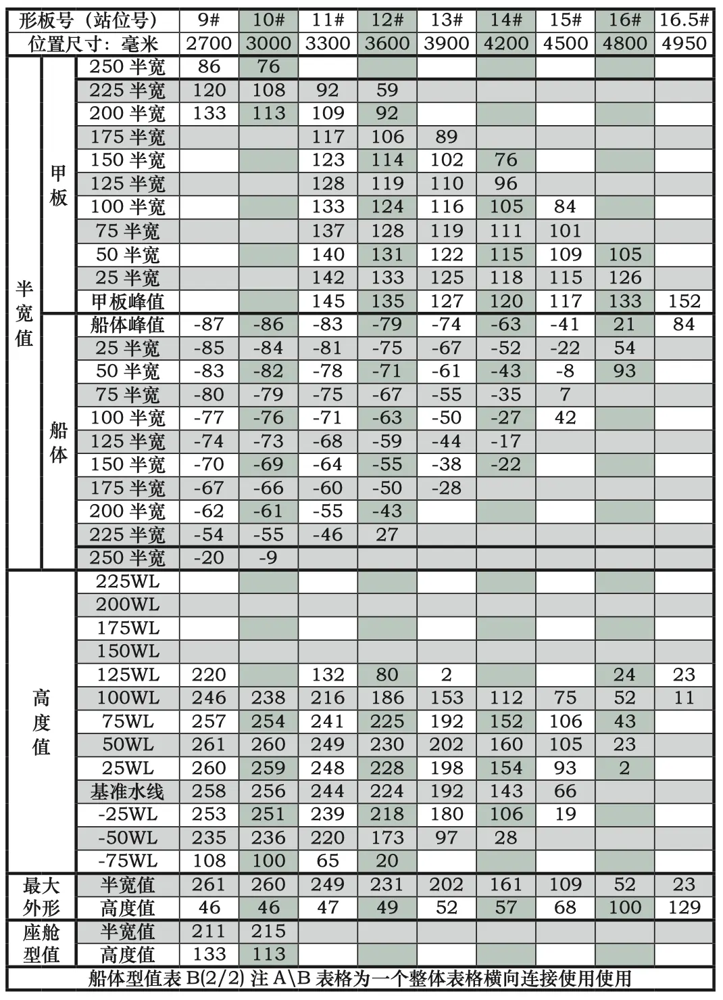

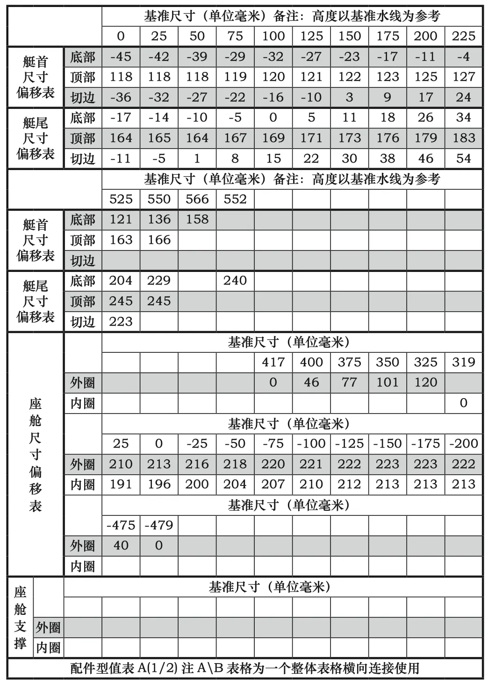

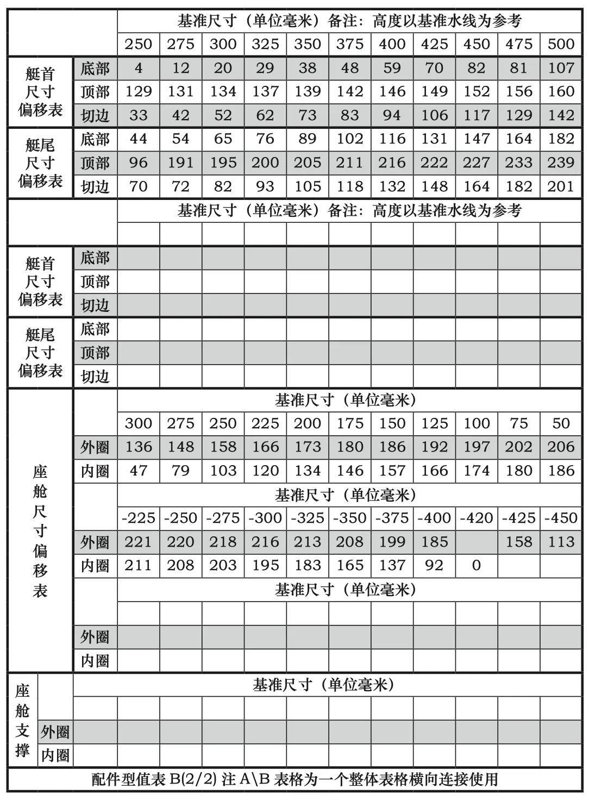

### 一、看标题栏和主尺度
根据标题栏和主尺度可以了解皮划艇的基本类型和大小，这个皮划艇名称是：澎逸海海王子5.1 米；皮划艇设计原型是格陵兰纽因特皮划艇；总长度为 5.1米，垂线间距为300 毫米，共有 18 个形板 头尾各有一个 1/2 站位。

### 二、看型值表

为了将皮划艇的形状表示更清晰，皮划艇的型值表是单独两页来记录的。这样图纸和型值表可以对应。一方面方便识图，另一方面也方便加工中使用。皮划艇的型值表分为两页。第一页型值表记录的是整个皮划艇的船体数据。第二页是记录的皮划艇配件的数据。第一页记录了各个型线交点的半宽值和高度值；第二页皮划艇艇首和艇尾龙骨截面型值；皮划艇座舱内外圈的型值。第二页的型值表是在传统的型值表上根据皮划艇的特殊性而设置增加的。根据型值表对照三视图可以知道三组截交线的位置、数量、间距以及各个型线交点的型值。由图上型值表可以知道：

1. 沿着皮划艇的长度方向将垂线间长分为 17
等分，共有 16 个站，站距为 300mm，皮划艇的中心是第 8 号站，在船首有增加了一个 16-1/2 站，皮划艇尾部增加了 1/2 站。
2. 沿着船的深度方向有 10 条水线（不包含基线）除了 0W/L 为设计水线外，其他的水线间距为 25mm，设计水线高度为 0mm
3. 沿着船宽度方向每个侧面有 10 条纵剖线（除了中纵剖线）分别间距为25mm。
4. 型值表二中还单独有标识皮划艇船首外形轮廓型值表和皮划艇尾部外形轮廓型值表。船首和船尾外形轮廓型值表是描绘的外形轮廓和水线交点的型值。
5. 型值表二中还有座舱圈的型值表，是以 8 号站位为基准标识出来，包含凹陷尺寸和内圈尺寸的型线值
6. 型值表中没有座舱支撑板，在型值表中的值为空。

### 三、识读三视图；首、尾截面图和座舱圈图
识读三视图时候应该对照型值表，同时各个视图之间也应相互对应。识读时候可以逐个视图识读。首先了解三视图的布置形式。图中可以看出，该型线图是采用的第一视角投影法布置形式。中国国家标准中，一般都是第一视角投影法布置的图纸，另外增加三个辅助视图，一个皮划艇的艇首龙骨截面图，一个是皮划艇的艇尾龙骨截面图和座舱圈图。

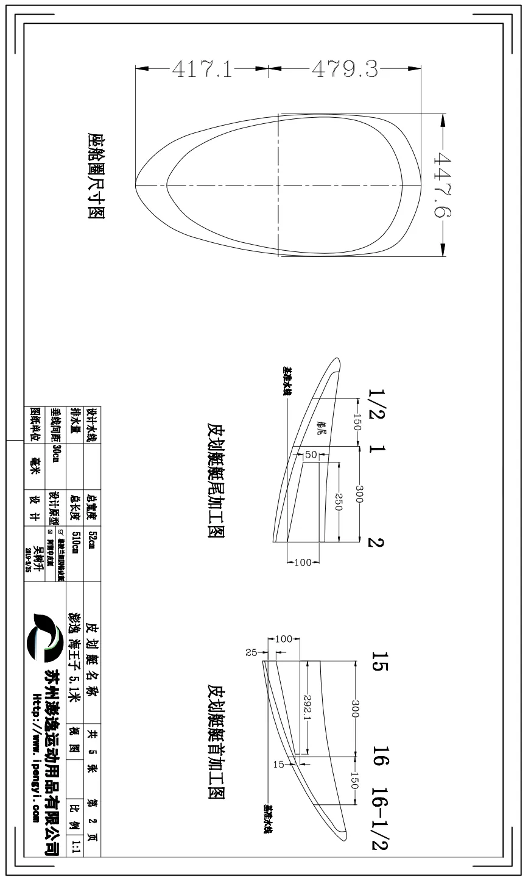

#### 1. 识读纵剖线图
纵剖线视图中的中剖线反映的是皮划艇整体外形的实际形状，建造好的皮划艇的头尾样式。其他的剖线是距离中剖线一定距离剖切后的形状。
纵剖视图的格子线是水平的水线与垂直的站线，与横剖视图和半宽水线图中相应的水线和站线对应。
#### 2. 识读横剖线图
横剖线图反应的是皮划艇站面的实际形状，也就是我们制作形板模具的形板截面形状。皮划艇的整个截面都是圆顺过度的流线形状，为了更清晰表达我们定义水线距离和纵剖线的间距都是 25 毫米。线条越密集，所得到的数据越多，截面越精确。
半宽水线图的格子线是水平的水线与垂直的纵剖线，水线和纵剖线和半宽水线图是对映的。
#### 3. 识读半宽水线图
半宽水线图反应的是座舱的位置，皮划艇的宽度外形形状，以及站面的布局分布情况。皮划艇的长度方向上的流线因为长度长，对应的截面变化比较小，所以站距相对比较大，一般都可以在 300 以上的站距。也有利于我们在建造过程中，用木条来拉出流线曲面。同时要注意仓口和座舱的位置，这个都是在半宽水线图上标注展示出来的信息。
半宽水线图的格子线是水平的纵剖线和垂直的站线，纵剖线和站线均和纵剖线图和横剖线图一致。
#### 4. 识读首、尾截面图和座舱圈图
这个是为了建造皮划艇而单独设计的几个视图，是单独展示皮划艇艇首和艇尾截面形状，以及和站位的关系，首、尾截面图中，一定会靠着一个站位的形板，穿过一个甚至多个站位形板。方便水线基准没有在站位形板内的形板进行定位安装固定。看图的时候特别注意站位形板位置和基本尺寸。
座舱圈图一般会包含三个部分，内舱圈尺寸，座舱凹陷的最大外形尺寸，如果有座舱支撑板，也会在这个视图中绘制，如果没有座舱支撑板，就会标识内圈尺寸和凹陷尺寸。识读中注意图纸的基准是以站位为基准的。宽度中心是皮划艇的宽度中心线。长度的 0 基准是以皮划艇的站位形板为基准。海王子图纸中的皮划艇座舱是以 8 号站位形板为中心绘制的。安装也是以这个形板为基准。
通过型线图可以了解皮划艇的大小，形状，皮划艇外形板沿着长度宽度和深度方向的变化。了解这些，方便后面皮划艇的整体加工制作。

---

> **转载声明**：本文转载自吴树升《艺术级皮划艇建造技术》（[原文 gitee 仓库](https://gitee.com/feathercraft/how-to-hand-build-a-kayak)），
> 经作者授权以 **CC BY-SA 4.0** 许可公开，转载请署名并以相同方式共享。收录台账见本站 RIGHTS 台账（rights: cc）。
