# 第六章 艺术造型设计
如何定制你专属的艺术级皮划艇，怎样规划个性的设计方案，如何实现特殊的纹理结构。具体方案都会在本章详细介绍。

## 第一节：常见木料介绍

木材颜色是多种多样的 , 不同的木质材料 , 它的色彩也是不尽相同。不同颜色搭配给皮划艇的艺术设计提供了无限的可能。皮划艇本身优雅的流线造型，配合不同颜色的木头，可以拼合出来个性的艺术效果，制作全世界独一无二的专属皮划艇。

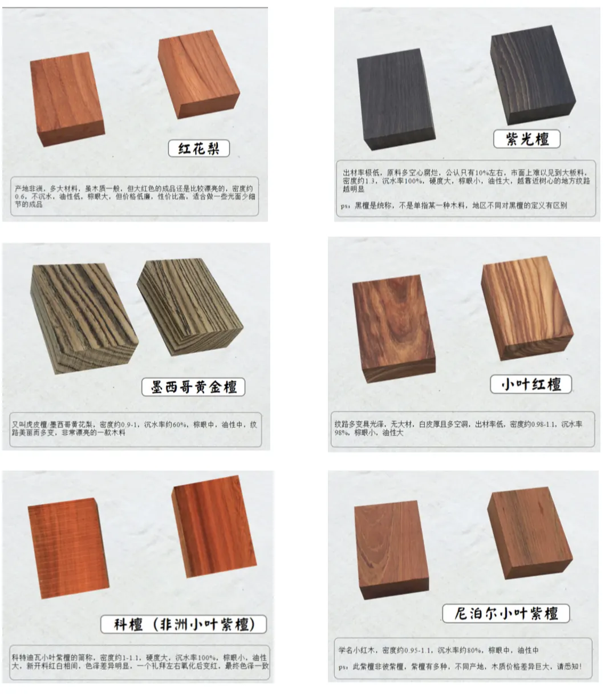

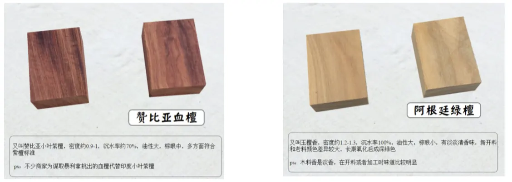

## 第二节：贯穿式条纹
皮划艇船体浸没在水中展示出来的外观面少，对应装饰也少。可能就是艺术 logo 贴花会在船体上。皮划艇装饰花纹 95% 的装饰都是在甲板上。整个皮划艇的甲板都是你的画板，用不同颜色的木条来做装饰图案。让皮划艇更有艺术的美感。

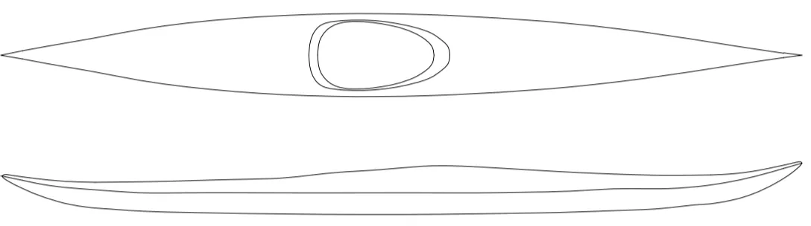

我们可以用笔勾画出来上图这样的图形，根据你自己的想象，使用彩色的水笔来勾画出来你的皮划艇的线条。最简单的方式是我们选择一个和松木板白色对于比较大的颜色，比如红松，紫光檀等木材，加工出来木条。可以贯穿皮划艇的整个船身。我们尽量采用对称设计。具有艺术美感的同时，可以有平衡感。这个贯穿船身的颜色木条，不一定是甲板和船体结合的轮廓线，你可以任意方式设计。布置好这个线条后，用普通的松木填补其他的空隙。

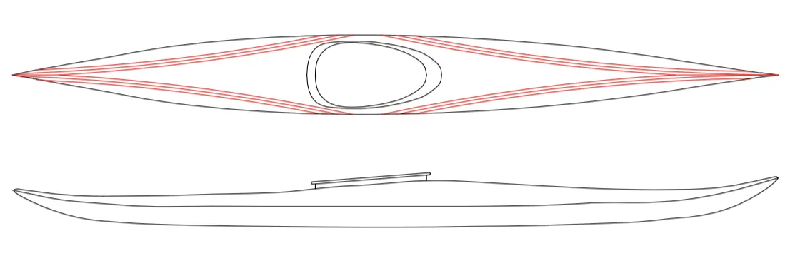

依照这个方式你可以自由绘制你想要的皮划艇图案。然后根据你自己的设计来建造。这个也是最简单的艺术处理。

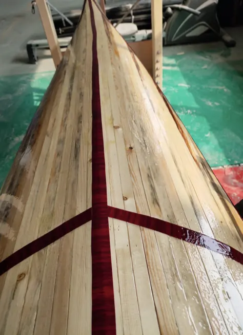

在建造的过程中，我们是以最长条的木条先拼接加工。形成我们需要的艺术形状，然后在填补其他的木条。而木条的柔软度，不会让你局限于非常特定的形状，木条自然就会形成很优美的曲线。

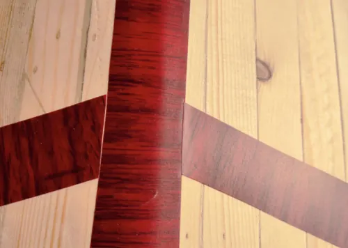

如果在甲板上加工成为上图的对称布局样式。也可以加工出来。我们先会加工好甲板中心位置的木条。定位好后，在每个木条修正和中间的木条结合起来。加工起来工作量会很大，不过艺术的造型会非常完美。让你的皮划艇称为一个不折不扣的艺术品。

## 第三节：拼合式条纹

贯穿式的条纹，皮划艇铺设加工会相对简单，但是木条整条切割和木材的购买比较困难。另外一种就是根据我们需要，购买很多的边角小料，用各种边角料来拼合成各种组合图案，然后在安装皮划艇上。这样皮划艇的样式会更加唯美，多变。木料可以选择本章开始讲的各种木料。在网上可以购买到非常多的边角料。这个边角料对于我们加工皮划艇来说已经足够了。皮划艇木条宽度是 20 毫米厚度是 6 毫米边角料满可以满足这个尺寸要求。尽量依照这个规格尺寸来设计各种的图案变化。

我会去找书签的瑕疵料，或者其他红木家具厂的边角，也会找 5 毫米的圆棒料。我们加工好后用乳白胶粘合在一起，形成我们需要的图案。圆柱在孔上涂抹胶水粘合，然后用砂纸打磨平整，形成我们需要图案形状。

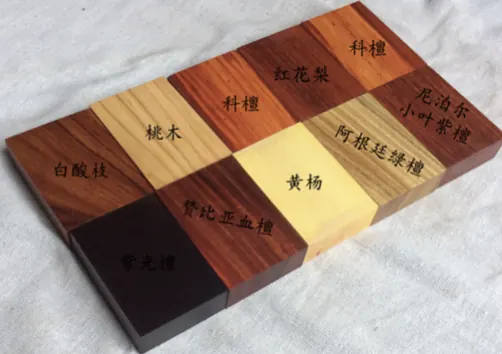

各种图形的拼合随着你的思想任意发挥，形状、颜色都可以组合起来。可以一条木条上来做，也可以用相邻的几条木条一起拼合，形成一个比较宽的装饰条纹。整齐统一后花纹都会很漂亮。不过做的越多，工作量也会越大。

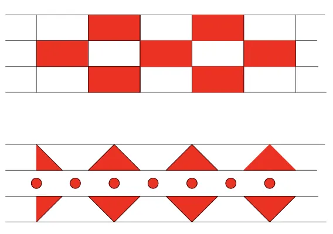

特别注意，粘合时候要保证每片的形状都相同，然后用夹具夹持好后在拼合。

这个木条装饰不一定贯穿皮划艇，在皮划艇的任意位置都可以做一段。这个完全看你的设计和喜好。只需要注意一点，加工的形状图案要有统一的尺寸，不要不能粘合在一起，造成变形。

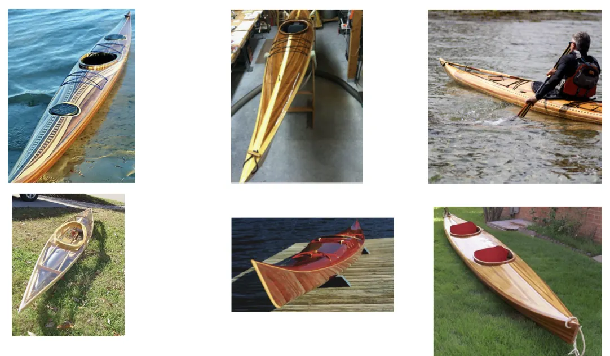

国外皮划艇大师的作品贯穿条纹和拼花条纹综合应用在皮划艇上

## 第四节：其他的个性化装饰风格

如果你觉得使用整条木条来装饰皮划艇或者使用木条拼接几何图形太麻烦，可以考虑使用贴花方式来做个性化的装饰。在皮划艇拼合好并完成抛光后进行表面装饰。可以选择装饰的工艺很多，比如木条上的烫画、使用油漆绘制图案、剪纸贴花进行装饰甚至植物叶子，鸟的羽毛都可以装饰你的皮划艇。

### 进行装饰前需要完成的工作
进行皮划艇的个性化装饰是艺术级皮划艇技术的一部分，需要提前设计并且整体规划好。对皮划艇进行装饰前需要保证完成基础的工作。防止对我们设计有破坏的工序存在。

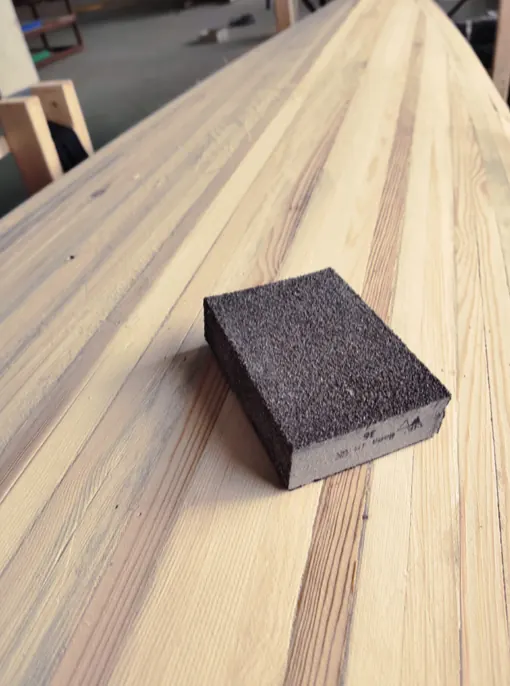

我们铺设好木条后，会先对皮划艇的外观面进行整体抛光。使用电动抛光机也好，手工抛光也罢，基本的抛光顺序是按照砂纸的粗细号数进行的。从 80# 砂纸粗抛开始，然后是 150#、 230#、320#砂纸。松木木条更好的和玻璃钢树脂结合，我们最高抛光到 320# 砂纸即可。

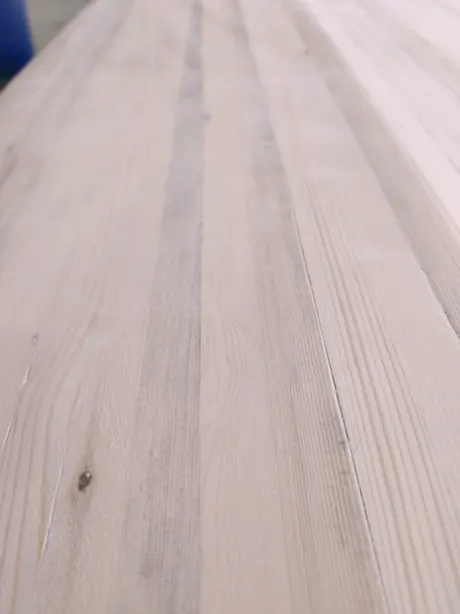

抛光到 320# 后的效果，手摸起来会非常光滑，感觉不到凸凹的起伏，看起来也会有光泽。完成抛光后在对皮划艇的外壳进行艺术装饰创作，对后续工作不会有影响。

### 使用烙画工艺装饰皮划艇

烙画古称 “火针刺绣”，近名 “火笔画”等，是中国古代一种极其珍贵的稀有画种。据史料记载，烙画源于西汉、盛于东汉，后由于连年灾荒战乱，曾一度失传，直到清光绪三年，才被河南南阳的一名叫 “赵星”的民间艺人重新发现整理，后经辗传，逐渐形成以河南、河北等地为代表的几大派系。  烙画以前仅限于在木质材料上烙绘，如：木板、树皮、葫芦等。画面上 自然产生不平地肌理变化，具有一定地浮雕效果，色彩呈深、浅褐色乃至黑色。烙画用一种特制的铁笔，在扇骨、梳篦、木制家具以及纸绢等上面烙制成的工艺画。

我们根据自己实际需要在皮划艇上进行烙画创作。烙画不一定需要美术功底，可以寻找 自己喜欢的图样在皮划艇的对应位置上描绘出来，然后使用电烙铁根据线条烫在皮划艇的木条上，形成艺术装饰效果。

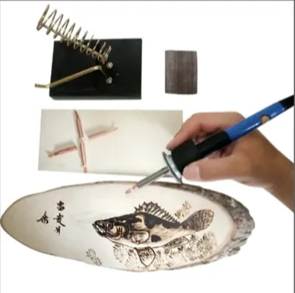

工具使用普通的电烙铁即可，烫木板的温度大约 400-450 度，电烙铁的头部可以选择细一点的用来描绘线条，使用粗一点的做面的颜色。电烙铁的使用和用笔方式一样。烫画的时候不要一次烫的颜色很深，一遍一遍的加深颜色达到最终的效果。

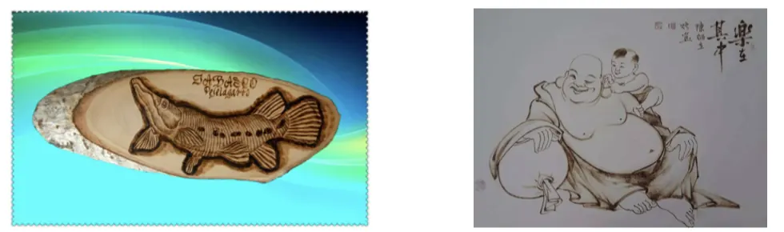

选择自己喜欢的图形图案，打印出想要的大小，使用铅笔在甲板上描绘出来，也可以用圆珠笔在木条上绘制一个印痕，后续使用电烙铁根据痕迹来烫出我们想要的图形效果。

烫画工艺简单可操作性强，失败了抛光一下就可以继续加工，而且灵活多变，可以给自己独一无二的皮划艇增加上灵魂创作。是非常好的一种艺术工艺。需要注意的是烙画的区域木条拼合紧密，不要有空隙影响美观，木条尽量是相同材质的木条，否则深浅颜色不同会影响烙画的效果。

### 表面剪纸贴花和其他装饰

剪纸或者打印出来的油墨图画会比烫画更简单可行，用来装饰皮划艇也是非常不错的选择。纸张可以使用宣纸或者那种很薄的描图纸，在上面打印出来图片、装饰图形或者你想要的 logo。然后用玻璃钢树脂封在皮划艇上。纸张不会像玻璃钢纤维布那么柔软，所以选择的位置尽量平坦，可以让纸张平整贴合。

刷上树脂后，树脂会使纸张接近透明，只会看到留下的油墨。油墨的选择尽量选择不会褪色的油墨，玻璃钢树脂会把画封闭在木头表面，但是受到阳光中的紫外线照射，有的色彩会褪色。尽量使用户外抗 UV 的油墨，这种油墨在做户外招牌的广告店铺中很容易找到。

粘贴画的时候，在皮划艇需要粘贴的位置刷一层树脂，然后把画贴上，用树脂从一头慢慢过渡防止有起泡困在内部，刷满整个画后在铺设玻璃钢纤维布，这样固化后不会影响后续的加工工艺。这个位置会比其他的位置厚一点点，不仔细辨别是发现不了。

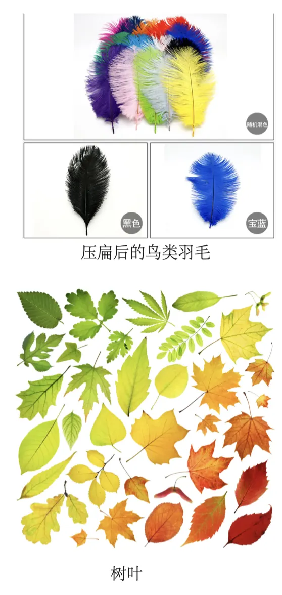

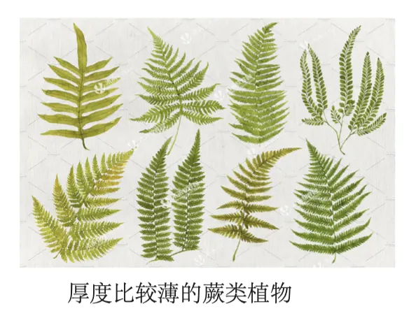

压扁后的鸟类羽毛（需要把中心的羽毛管处理平整，否则会突出很高）、树叶、比较扁平的蕨类植物都是非常好的装饰品，会给你的皮划艇增加很多个性亮点。我们需要给装饰品做扁平化处理，比如中心的羽毛管子，树叶的叶脉，尽量压成纸张一样的薄片，方便后续铺设。我们不用管叶片的湿度，新鲜的叶片也没有问题，被玻璃钢树脂包裹后是不会腐化的。这类饰品加工在皮划艇上的处理方式和纸张处理方式是一样的过程，也是在皮划艇木条上刷上树脂摆放装饰品，然后在表面刷一层树脂同时铺设玻璃钢纤维布在上面。

### 木纹贴纸装饰
不想使用其他的颜色的木条还想做出各种木条拼合的艺术效果也可以用木纹贴纸来进行处理。木纹贴是类似于不干胶贴纸的一种木纹表面装饰产品。可以做皮划艇各种的特色条纹。使用木纹贴必须要完全处理好皮划艇的表面，填补空隙打磨抛光后在使用。

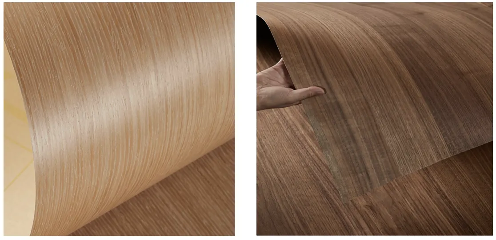

木纹贴的颜色多种多样，选择的时候尽量选择表面粗糙一点的，不能太光滑。太光滑的和树脂不能良好的粘合，铺上玻璃纤维布后是雾蒙蒙的效果，达不到我们想要的要求。粗糙的表面可以和树脂更好的结合，显现出来的效果会很好。这种方式一定没有使用不同颜色材质木条拼合的效果好，就是也可以起到装饰作用的一种方案。

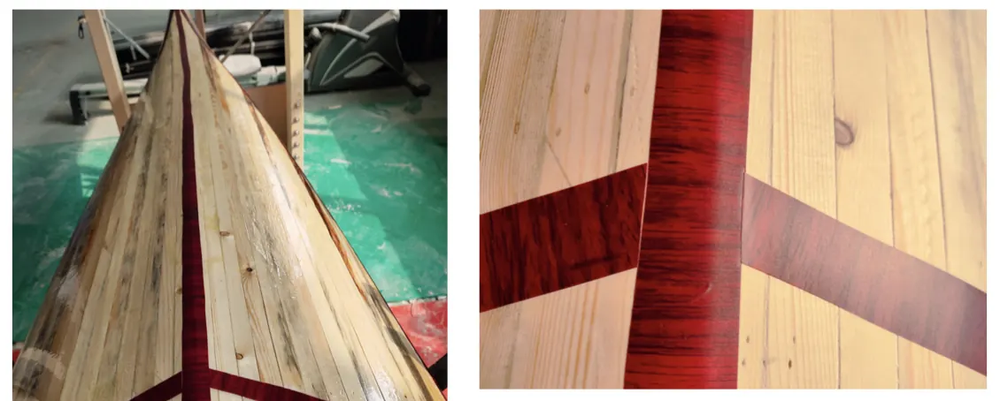

这两张图片可以看到木纹贴粘合后的样子和刷好树脂后的样子。如果追求完美尽量使用木条拼合方式，如果就是为了装饰个性可以选择这个方案，非常简单可行。

### 使用木片拼画做装饰

木片拼画也是非常有个性的一种装饰风格，用不同颜色的 1-3 毫米的木片加工出来不同的形状图形，对于皮划艇也是一种独特的艺术处理方式。木片厚度的选择是根据不同的图形和效果来确定的。

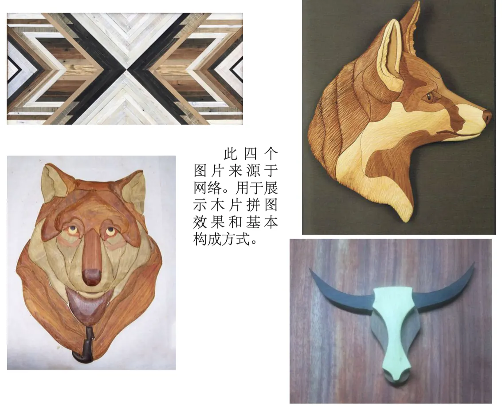

此四个图片来源于网络。用于展示木片拼图效果和基本构成方式。

组装木片拼画，先用胶带将其固定在一起。在皮划艇和拼画上涂一层环氧树脂。不能涂太多环氧树脂，防止树脂流动。把拼画放好并按住。使用塑料缠绕膜拉近固定，缠绕膜拉的越紧越好。把整个拼图都覆盖上固定住保证与皮划艇贴合。缠绕好第一层缠绕膜后，可以用泡沫或者其他有弹性的东西压住拼画保证每个点都受力压在皮划艇上，在用缠绕膜缠绕固定上。

环氧树脂凝固后，取下缠绕膜和胶带。塑料缠绕膜可能会和树脂粘合在一起，尽量少使用树脂胶水，用刮刀和砂纸去除缠绕膜粘合的位置和多余的树脂胶水。清理环氧树脂时，不要损坏拼画。

粘合完成后可以正常地给皮划艇上玻璃纤维布。由于拼画不是镶嵌的，在铺设玻璃纤维布的时候，围绕拼画的边缘一定会有一个过渡的位置。要比较小心的处理这个位置的玻璃纤维布。可以分开两次铺设，先铺周围的位置，给拼画的位置裁剪掉。铺设好后在从拼画上开始铺设玻璃纤维布，周边留出来3-5厘米的搭接位置。保证强度的同时可以更好的处理拼画的边缘和皮划艇表面的过渡。能保证拼画的形态，还能很好的结合皮划艇的表面。

### 油漆装饰

最后一种打扮你皮划艇的方法，我只简单地谈一下。可以用油漆来处理你的皮划艇。可以全部喷涂、局部喷涂、或者直接用油漆做艺术处理。使用油漆处理，你不必非常谨慎小心的铺设木条，可以使用原子灰或者树脂直接填充缝隙，然后整个做刷漆遮盖处理。也可以使用很差的木条来铺设，都看不出来木材的效果，都会被油漆遮盖住。油漆可以选择你喜欢的颜色。直接用油漆作画也没有问题。

用原子灰填补一下空隙。然后整个船体刷一层玻璃钢树脂，使用砂纸抛光到 320# 后，可以刷底漆了。注意：木工油漆一般都需要三层以上，一层底漆，要很光滑，油漆的光滑效果会根据底漆变化。不均匀的斑点会在油漆表面上比在光亮的木材表面上更明显。打磨完将铺设玻璃钢，铺设好后在继续抛光一次抛光到 320# 以上。然后涂上一层适合玻璃纤维和油漆的厚底底漆，以填补任何小缺陷。然后继续抛光，抛光到 800# 砂纸后在上油漆完成油漆粉刷工作。

在这里需要提醒一下有的油漆和树脂是不粘合的，我们选择油漆需要选择环氧基涂料。所有的油漆都完成后需要在上一层清漆进行防护，减少以后刮伤划痕等维护的工作。光亮的油漆要仔细打磨的。打磨抛光越好，油漆越光亮。

### 艺术的创造力
我在这里所说的所有艺术化的方式，都可以说是非常浅薄的，只能起到抛砖引玉的作用。有无数种方法可以让你的皮划艇艺术化、个性化、特色化。艺术的装饰需要时间揣摩推敲。但是皮划艇就是皮划艇。我们享受制造的乐趣的同时更是要享受水上的乐趣。你要是想做的就是下水的，那就不用花费什么心思，造好下水就好了。皮划艇真正的美不是看起来是什么样子，而是在于它在水上的操控性。

不过话虽如此，如果你有什么想法，那就尝试。每个人的思维都是不同的，你的一个小创意可能会有别样不同。最多是表面处理失败，抛光一下就好了，皮划艇还是那个皮划艇。不放心可以先找块小木板上，做下实验，在用到你的皮划艇上。

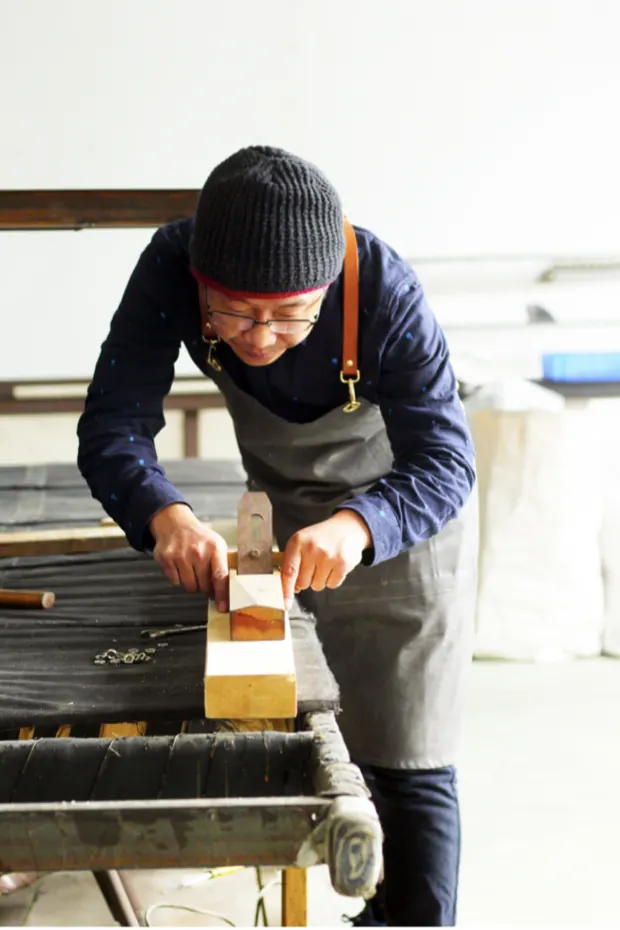

**图片6-20: 吴树升在车间工作照**

---

> **转载声明**：本文转载自吴树升《艺术级皮划艇建造技术》（[原文 gitee 仓库](https://gitee.com/feathercraft/how-to-hand-build-a-kayak)），
> 经作者授权以 **CC BY-SA 4.0** 许可公开，转载请署名并以相同方式共享。收录台账见本站 RIGHTS 台账（rights: cc）。
