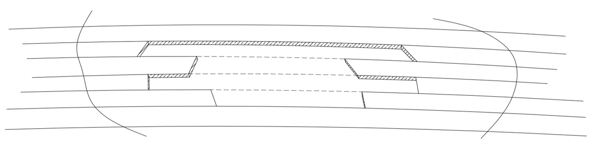

# 第十二章 皮划艇的维护和修理

皮划艇的日常维护、划痕处理、瘀伤处理以及孔洞修补在本章详细介绍。

## 第一节：皮划艇的维护保养
我们使用木条铺设的皮划艇和大多数木船相比不需要太多维护。最多就是每年开始玩皮划艇之前在皮划艇外观面上粉刷一层清漆。实际上可能两年到三年粉刷一次清漆也没有问题。在木条外层环氧树脂和玻璃纤维布混合的玻璃钢材料会比我们想象的结实。

我们更需要平时使用皮划艇的时候，注意皮划艇可能存在的磨损和划痕。特别是要找到损坏玻璃纤维的划痕，这个划痕需要及时处理防止影响皮划艇的使用寿命。我在划艇的过程中，如果遇到强烈的撞击或者不得已穿过很浅的岩石表面，我都会看看皮划艇确保没有损坏到木头。

### 正常磨损处理

如果皮划艇经常使用，我们在沙滩上拖拽皮划艇，或者划过很浅的水域都会对船体造成磨损。我们可以定期或者不定期的对皮划艇进行维护保养。我们会把皮划艇清洗干净，去掉在河水中粘上的水藻等杂物。然后在需要上漆的地方使用砂纸抛光，不用做粗抛，可以直接用 320# 砂纸进行抛光。去掉所有的划痕并且和周边区域结合到平顺光滑。然后粉刷清漆即可。船底部分是需要经常处理的。不用太精细，毕竟后期也会磨损。另外船体在水里，不会影响皮划艇的美观度。所以我基本都是保证使用，而不做精细加工。

甲板上出现划痕或者其他的损伤，对于表面维护是需要精细加工。甲板表面直接影响皮划艇的美观。
维护甲板的时候，需要移除甲板上安装的所有五金件和管线，用 320# 砂纸打磨，直到光泽消失。当你用砂纸把清漆打磨掉显露出来环氧树脂时，你需要注意到表面色调的变化。清漆和环氧树脂在打磨时候颜色不一样。应该避免打磨掉太多的环氧树脂。打磨的时候不用整个甲板全部打磨，去掉磨损的痕迹，保证周边结合平顺就可以重新上漆。上好清漆之后和新船一样，基本看不出修补过的痕迹。

### 严重划痕

皮划艇上会有一些严重的划痕，划破清漆甚至划到玻璃纤维布上。只要这个划痕没有让木条进水就不会有什么问题，不用立即处理，空闲时候修复即可。首先需要清洗干净，如果环氧树脂里面的玻璃纤维已经翘起了，可以用油漆的稀释剂或者丙酮来清洗，保证划痕内部都是清洁干净的。然后上清漆密封保护即可。如果想要去掉严重划痕，也可以用砂纸打磨抛光到平顺光滑，然后使用树脂填充打磨的凹陷部分，这个位置因为打磨的比较深，要分次处理。不要一次填充太多，等第一层凝固后还有点粘度的时候刷第二层，一直到填充好凹陷位置。然后在整体抛光到平顺光滑。最后上清漆，完成维护工作。

## 第二节：皮划艇的维修

### 处理大的瘀伤

木条配合玻璃钢的皮划艇强度很好，但是在使用过程中也可能存在很多严重划痕。比如不小心把皮划艇被搁浅到尖锐的岩石上。皮划艇运输中跌落在石子上。都可能在皮划艇上造成一个深入木材的瘀伤。损坏玻璃钢的同时也损害到船体木条。因为有内层防护不会漏水，使用是可以临时使用，要是时间长会损坏木条，对整个皮划艇造成损害。

处理这类型的瘀伤和处理严重划痕类似。如果木条已经被水浸湿，可以先用淡水清洗一下瘀伤部分，去掉内部的杂质。然后晾干后在进行处理。不让水汽进入木条。晾干后，还是从打磨开始，打磨受损区域并清除所有松动的玻璃钢。然后把周边的区域打磨平顺，保证和边缘的过度平顺不会有厚度的突然变化。根据打磨的区域大小切割玻璃纤维布。这里需要两层加固，一层是和区域大小相同，另外一层要比整个区域大 5cm 左右。在受损区域涂上环氧树脂，从小到大依次铺设上玻璃纤维布。补丁固化后，用砂纸打磨光滑并重新上光 ，最后在上清漆。上好清漆后修补的位置和原来区别不会很大。不注意发现不了。

### 处理孔洞
如果皮划艇上不是划痕瘀伤而是一个孔洞，那就需要好好的修复处理了。一般的孔洞都会发生在船体的受力面，就是船体底部座舱的位置上。这需要从扩大孔洞的木条开始修补。

使用刀锯或者打磨机，把孔洞修整成为下图样式，让木条产生参差不齐的边缘。这样修补后的强度会更好。每个木条都会有交错的位置， 整体强度更高。彼此都有拉力，修补也会更方便。然后根据空隙尺寸，切割木条，木条还是一条一条拼合在一起用胶水固定好。固定的时候可以使用胶带粘贴在周围木板上，防止木条产生不平顺的问题。

胶水干了以后，用砂纸把修补的位置磨平顺光滑。在用砂纸把修补位置周边的区域的玻璃钢打磨掉。在这个区域可以铺设三层玻璃纤维树脂，玻璃纤维是从小到大依次铺设。皮划艇内侧和外侧一样方式处理，使用砂纸打磨掉周边区域，从小到大依次铺设玻璃纤维布，并且使用环氧树脂固化。

内外侧都处理好后，整体打磨抛光到 320 号砂纸，然后在分别使用清漆粉刷。如果修补的很小心谨慎，整体的效果可以和原始的非常接近。不过要注意使用木条的木纹，这个会有所差别。尽量使用和原始木条非常接近的颜色和条纹。保证修补的美观度。

---

> **转载声明**：本文转载自吴树升《艺术级皮划艇建造技术》（[原文 gitee 仓库](https://gitee.com/feathercraft/how-to-hand-build-a-kayak)），
> 经作者授权以 **CC BY-SA 4.0** 许可公开，转载请署名并以相同方式共享。收录台账见本站 RIGHTS 台账（rights: cc）。
