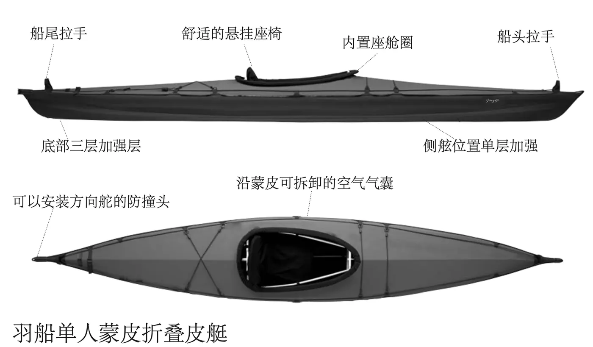
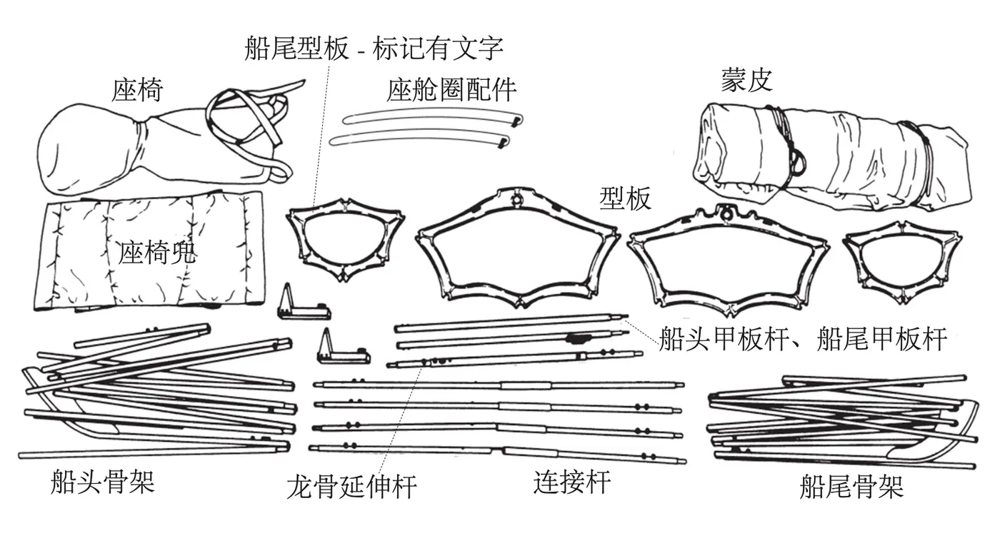

# PengYi 澎逸羽船系列

> 开启你的冒险之旅 🚣

澎逸羽船系列是一款蒙皮折叠皮划艇，致敬阿拉斯加划艇旅行设计，轻量便携，易于组装存储。

---

## 产品特点

- **轻量便携** - 船净重仅13.2-15.5公斤，包装尺寸小巧
- **舒适悬挂座椅** - 12毫米厚闭孔泡沫座位靠背和缓冲
- **优质材料** - 6061-T6铝合金框架 + TPU四层复合甲板 + 海帕龙船底
- **快速组装** - 无需工具，按图示步骤轻松组装
- **易于存储** - 拆解后可收入背包，存放于阴凉干燥处

---

## 规格参数

| 参数 | 羽船39 | 羽船45 |
|------|--------|--------|
| 长度 | 3.9 米 | 4.5 米 |
| 座舱宽度 | 60cm | 60cm |
| 重量 | 13.2 公斤 | 15.5 公斤 |
| 包装尺寸 | 80×45×30 厘米 | 90×45×30 厘米 |

**框架：** 16毫米6061-T6挤压型材铝管，透明膜阳极氧化处理
**型板：** 高密度聚乙烯（HDPE），全CNC加工
**甲板：** TPU四层复合工艺材料
**船底：** 海帕龙

---

## 标准配置

- 船体蒙皮 × 1
- 框架组件 × 1
- 甲板绳和捆绑绳索 × 1
- 可调节脚踏板 × 1
- 船体背包 × 1

---

## 可选配件

- 尼龙涂层防水裙
- 方向舵组件
- 可定制储物仓口
- 小腿护板组件
- 海袜

---

## 快速组装指南

组装仅需20步，详细步骤请参考[完整说明书](manual.md)：

1. **安装船头/船尾框架** - 将小型板固定到骨架上，插入脚踏板
2. **展开蒙皮** - 打开魔术贴搭扣，将框架滑入蒙皮
3. **安装龙骨延伸杆** - 连接船头船尾，展开并锁定
4. **安装座舱圈和座椅兜** - 滑入指定位置
5. **安装中间套管接头** - 对齐管子并连接
6. **安装大型型板** - 放置并卡入到位
7. **安装甲板栏杆** - 通过型板孔插入并锁定
8. **安装座椅和充气** - 固定座椅织带，给气室充气

---

## 维护与保养

### 框架保养
- 使用2-3个月后拆卸，用淡水清洗内外
- 使用润滑剂喷涂管件装配位置
- 每两个月完全拆解保养一次

### 蒙皮保养
- 划艇后用海绵去除积水
- 避免在尖锐岩石上拖拽
- 小破损可用修补包修复

### 存储要求
- 保持清洁干燥
- 可组装或拆卸状态存放
- 延长杆需完全分开

---

## 可选配件安装

### 方向舵
将方向舵销插入钥匙孔旋转180度，连接控制绳到脚踏板即可。

### 海袜
防水安全配件，防止仓内进水，闪亮面朝向框架，logo在右侧。

### 储物仓
连接舱口圈，通过甲板织物袖子连接密封圈，用插扣锁定。

---

## 联系我们

**苏州澎逸运动用品有限公司**

- 地址：江苏省苏州市吴中区甓直镇长虹南路（澄北村）
- 联系人：吴先生
- 官网：http://www.ipengyi.com

---

## 相关文档

### 产品文档
- 📖 [完整说明书](manual.md) - 详细的20步组装指南
- 📌 [安装技巧](install-tips.md) - 羽船装配和使用的小技巧（9个实用技巧）
- ❓ [常见问题解答](faq.md) - 保养、维修与安全指南

### 改装指南
- 🔧 [座椅改装指南](seat-mod.md) - 座椅系统改装教程
- 🔧 [脚蹬改装指南](footrest-mod.md) - 脚蹬系统改装教程

### 关于我们
- 📖 [拾遗之羽船诞生](origin-story.md) - 羽船创始人的十年研发故事
- 👤 [创始人简介](author.md) - 吴树升先生介绍

### 语言

---

**© 2023 苏州澎逸运动用品有限公司**

---

> **转载声明**：本文转载自澎逸运动用品《澎逸羽船系列》官方文档（[原文 gitee 仓库](https://gitee.com/feathercraft/pengyikayak)），
> 经作者吴树升先生授权以 **CC BY-SA 4.0** 许可公开，转载请署名并以相同方式共享。
