# 羽船的装配和使用的小技巧-看看有几个不知道

---

## 一、座舱前后两块白色大型板安装技巧

安装座舱前后的两块白色大型型板，不用区分前后顺序，需要注意，型板斜着插入艇内，先固定龙骨杆的位置，慢慢扳到垂直，在扳到型板完全竖直前，一定要让甲板边缘的两个杆子在型板的上方，再从蒙皮外侧推动杆子装配到正确位置，而不要让杆子从型板的两侧。从两侧推到正确位置会比较费力。

---

## 二、座舱支撑杆的安装小技巧

大家安装座舱支撑杆（翻滚杆）的时候经常有松垮的现象，杆子前后都有活动空间。平时使用是没有问题，在高强度的水域使用的时候需要调整一下安装次序，在安装好座舱前后型板后，把作为杠杆使用的后甲板杆安装到位，而不安装前甲板杆，让座舱前面的型板具有一定的变形空间。这个时候安装座舱支撑杆（翻滚杆）多推进一个卡簧位置，让前型板产生变形后在安装前甲板杆。这样翻滚杆不会有松动感，配合会很紧密。

---

## 三、容易被忽略的甲板拉紧织带

在座舱前后的甲板上分别有4条织带，这四条织带是绑在前后型板上的。可以有效地提高艇的整体刚性。

---

## 四、坐蔸布包裹臀部容易产生麻痹感的解决方案

羽船的坐蔸布是悬空的，优势是艇内有残存的水，不会一直坐在水里，划艇的坐姿也会提高，没有和水直接接触的触感。提高体感的享受。但是会发生包裹感很强，长时间划艇会产生腿部的麻痹感。可以使用两块瑜伽砖，垫在坐蔸布下面，这样长时间划艇就不会产生麻痹感。如果在旅行过程中，携带有其他物品，例如地垫等具有一定厚度的产品，也可以垫在坐蔸布下面，用以改善长时间使用的体感。

---方案提供人nicky，sitzfleisch

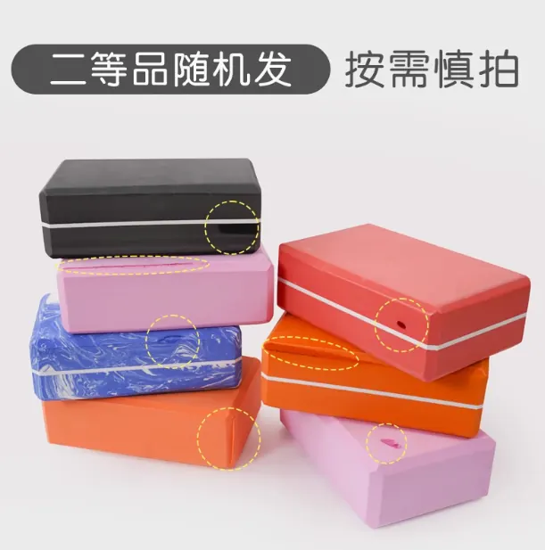

---

## 五、海袜放气不全产生包裹感的解决方案

在使用海袜的时候，首先注意内外侧的分别，布料面是贴合人体的光亮背胶面是套在艇上，安装好后，可以在海袜内部放置一个泡沫板，厚度1-1.5cm宽度40cm长度50cm，这个泡沫板放在海袜内支撑开空间，不会包裹腿。使用起来会非常舒服。在岸上的时候还可以垫在皮划艇底部，对艇进行防护。

---方案提供人野水

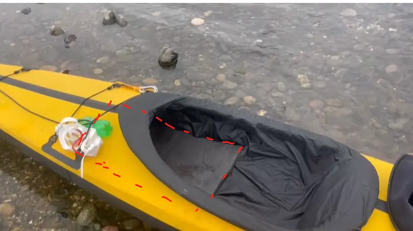

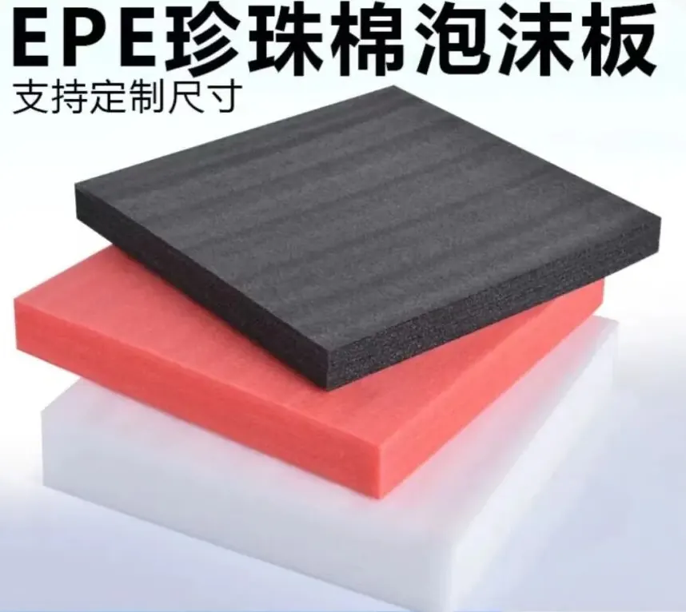

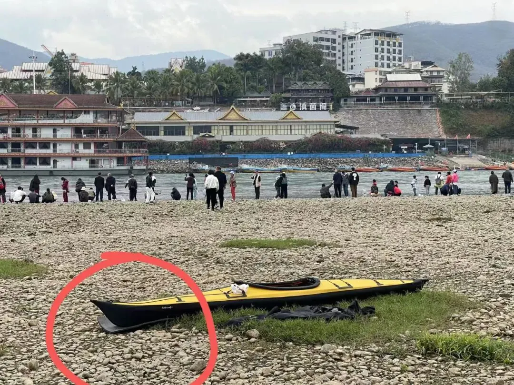

---

## 六、卡簧拆卸手指力量不足的小技巧，卡簧弹出不顺的调整方式

卡簧卡住龙骨杆或者座舱杆后，压下去用手指直接按会比较费力，可以使用作为杠杆使用的甲板杆头部不锈钢销钉按下去。这样会非常方便按下卡簧。

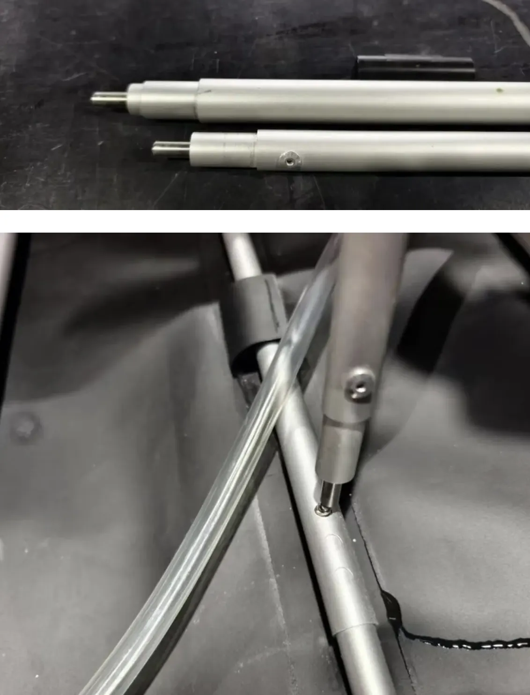

也可以使用捆绑座舱加强杆（翻滚杆的织带垫着按下去）

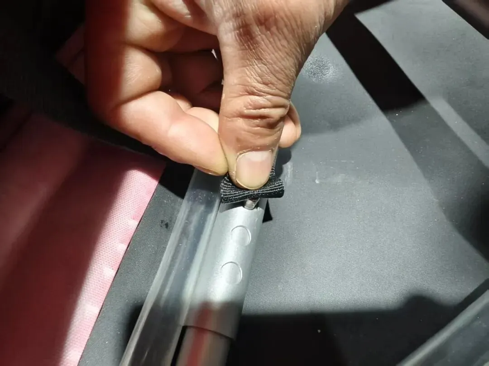

偶然会出现卡簧弹出不到位的现象，遇到这种情况是因为卡簧在管子内部姿态不正确造成的，取下这个带有卡簧的管子，在地面垂直撞击一下，卡簧位置即可自动调整好。

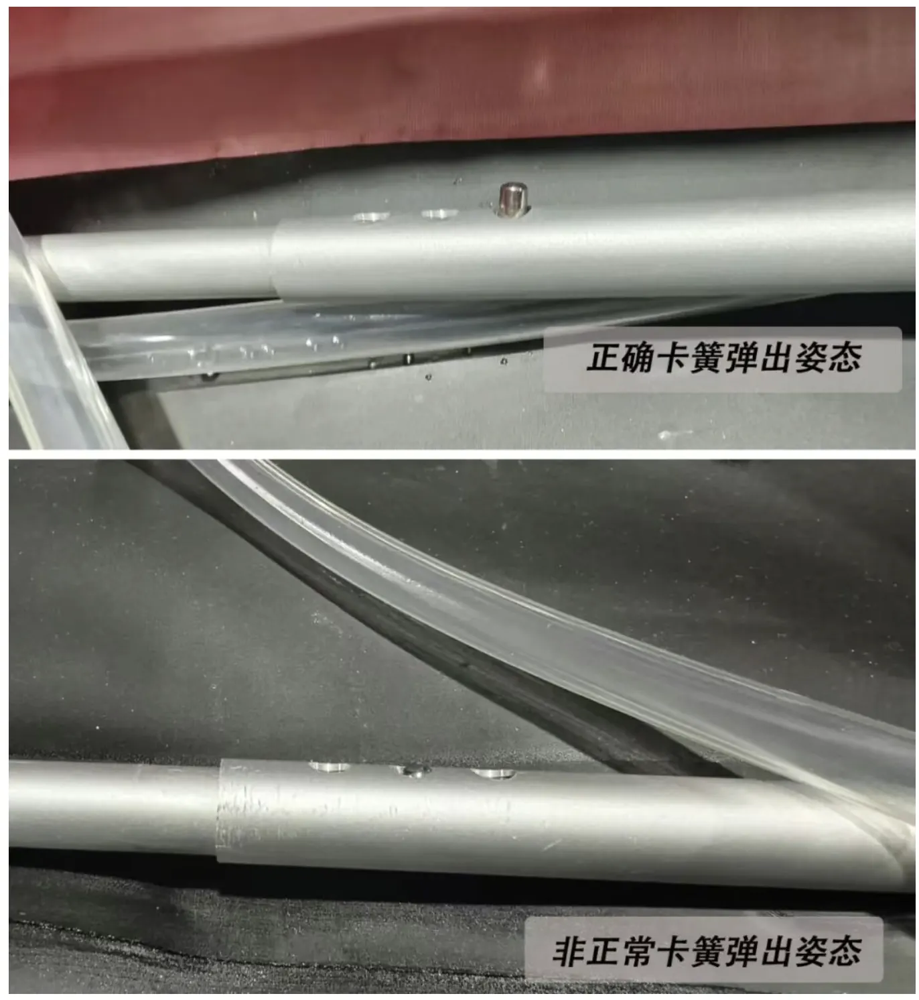

调整方式如下:拆下这个带有卡簧管子，带有卡簧这一头向着地面撞击两下。卡簧会自动复位

---

## 七、建议使用羽船必用海袜

海袜是很有必要的安全措施。可以有效地防止框架式皮划艇翻艇后大量进水的问题。折叠艇翻艇，人脱艇后，水不会进入艇内部，而进入海袜，通过翻转海袜的方式可以直接清理掉皮划艇内的水。非常方便。也避免了皮划艇进水太多不好清理的问题。

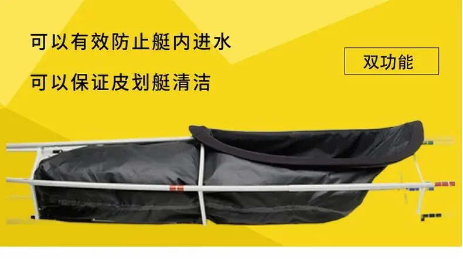

海袜也可以有效的避免折叠艇内部进入沙子等脏污。泥沙进入折叠艇内会非常难清理。泥沙会磨损框架的铝管，也会对蒙皮气囊造成伤害，特别是进入气囊室内后，气室充满气，沙子会直接磨损气室，造成漏气问题。产生安全隐患。海袜可以有效地避免这个问题。

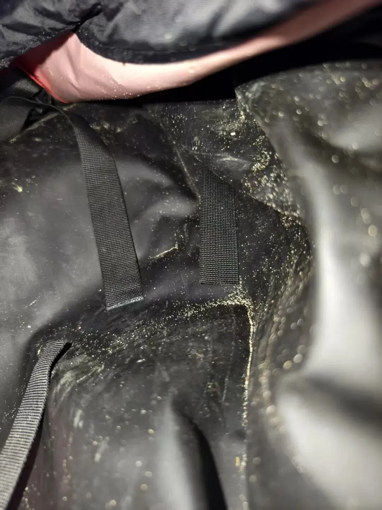

---

## 八、使用绑扎带在海划中增加羽船的强度

在海划或高强度的情况下使用羽船，建议使用可以重复使用的绑扎带对羽船型板和铝合金框架进行捆绑。这样可以有效的增加羽船的刚性和强度。

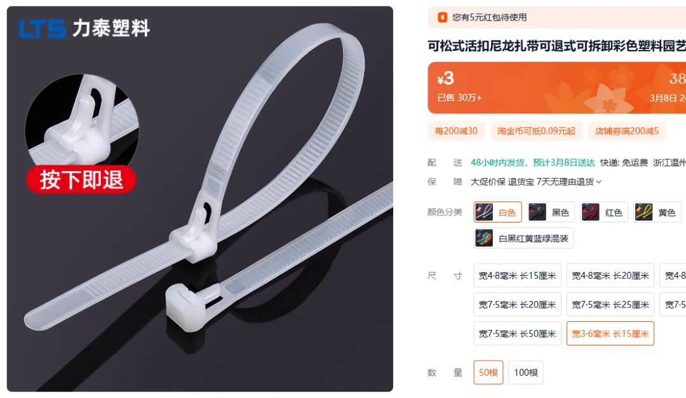

---

## 九、膝盖顶在座舱支撑杆（翻滚杆）不舒服的解决方案

羽船的座舱支撑杆（翻滚杆）还有支撑膝盖的作用。部分人的膝盖会顶在杆子上面，膝盖会不舒服，这种情况可以使用发泡的泡沫板捆绑在座舱支撑杆，膝盖会很舒服，翻滚的时候也会更贴合。

--方案提供人：佚名

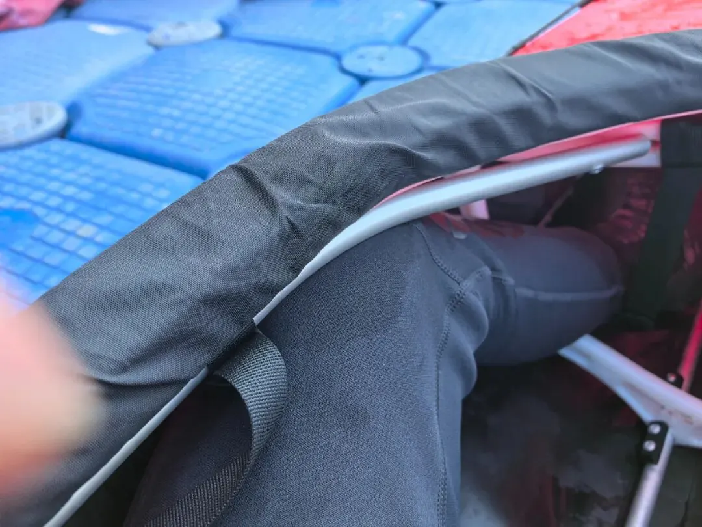

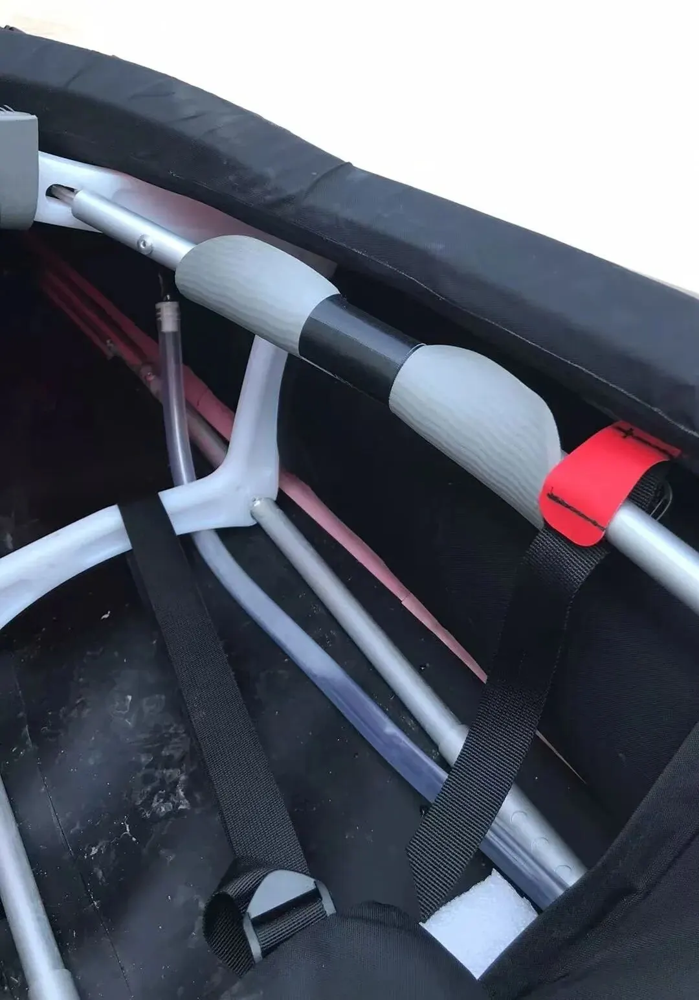

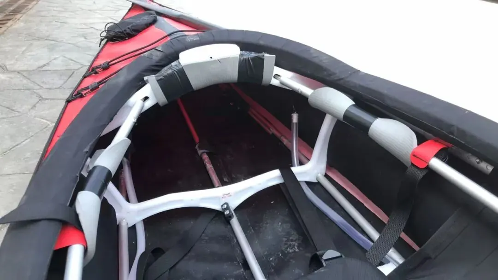

---

**来源：澎逸折叠皮划艇**
**微信公众号：澎逸运动用品**

---

> **转载声明**：本文转载自澎逸运动用品《澎逸羽船系列》官方文档（[原文 gitee 仓库](https://gitee.com/feathercraft/pengyikayak)），
> 经作者吴树升先生授权以 **CC BY-SA 4.0** 许可公开，转载请署名并以相同方式共享。
