# PengYi 羽船系列说明书

---

## 封面

开启你的冒险之旅

**羽船系列说明书**
(致敬阿拉斯加划艇旅行)

江苏省苏州市吴中区甪直镇长虹南路（澄北村）
联系人：吴树升 先生
网址：http://www.ipengyi.com

澎逸

---

## 目录

- 羽船系列单人蒙皮折叠皮艇 ……………………………………… 第2页
- 规格说明 …………………………………………………… 第3页
- 羽船的框架 …………………………………………………… 第5页
- 护理和维护 …………………………………………………… 第6页
- 拆卸 …………………………………………………………… 第7页
- 羽船装配说明 ………………………………………………… 第9页
- 羽船海袜 ……………………………………………………… 第23页
- 可选的方向舵安装 …………………………………………… 第24页
- 可选的储物仓安装 …………………………………………… 第28页

---

## 羽船单人蒙皮折叠皮艇

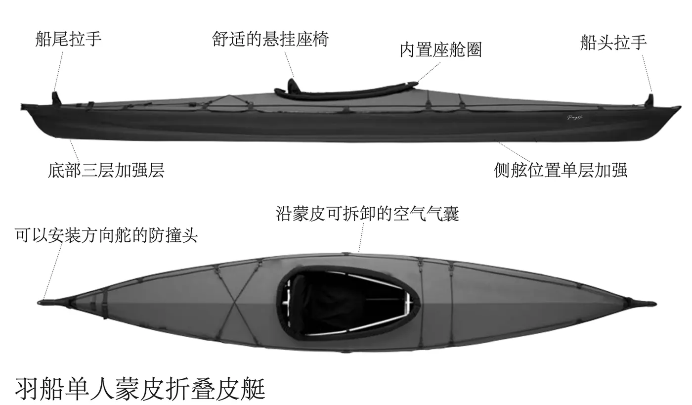

**产品特点：**

- 船尾拉手
- 舒适的悬挂座椅
- 内置座舱圈
- 船头拉手
- 底部三层加强层
- 侧舷位置单层加强
- 可以安装方向舵的防撞头
- 沿蒙皮可拆卸的空气气囊

---

## 羽船39 规格参数

**基本参数：**

- 长度：3.9 米
- 座舱位置艇宽：60cm
- 重量：13.2 公斤（船净重）
- 包装尺寸：80x45x30 厘米
- 存储容量：中等

**框架信息：**

- 16 毫米直径圆管
- 6063-T6 挤压型材铝管
- 外表面透明膜阳极氧化处理

**支撑型板：**

- 高密度聚乙烯（HDPE）
- 全 CNC 加工

**甲板材料：** TPU 四层复合工艺材料

**船底材料：** 海帕龙

**座位：** 12 毫米厚度的闭孔泡沫座位靠背和座位缓冲。靠背内置聚丙烯板，使用 420D 尼龙布制作的护套。

**标准配置清单：**（每个船艇包含的配件）

- 船体蒙皮 1 套
- 框架组件 1 套
- 甲板绳和捆绑绳索 1 套
- 可调节脚踏板 1 套
- 船体背包 1 个
- 安装说明书 1 本

**可选配置清单：**

- 尼龙涂层防水裙
- 方向舵组件
- 可定制储物仓口
- 小腿护板组件
- 海袜

---

## 羽船45 规格参数

**基本参数：**

- 长度: 4.5 米
- 座舱位置艇宽: 60cm
- 重量: 15.5 公斤
- 包装尺寸: 90x45x30 厘米
- 存储容量: 中等

**框架信息:**

- 16 毫米直径圆管
- 6063-T6 挤压型材铝管
- 外表面透明膜阳极氧化处理

**支撑型板:** 高密度聚乙烯，全 CNC 加工

**甲板材料:** TPU 四层复合工艺材料

**船底材料:** 海帕龙

**座位:** 12 毫米厚度的闭孔泡沫座位靠背和座位缓冲。靠背内置聚丙烯板，使用 420D 尼龙布制作的护套。

**标准配置清单:** (每个船艇包含的配件)

- 船体蒙皮 1 套
- 框架组件 1 套
- 甲板绳和捆绑绳索 1 套
- 可调节脚踏板 1 套
- 船体背包 1 个
- 安装说明书 1 本

**可选配置清单:**

- 尼龙涂层防水裙
- 方向舵组件
- 可定制储物仓口
- 小腿护板组件
- 海袜

---

## 羽船框架

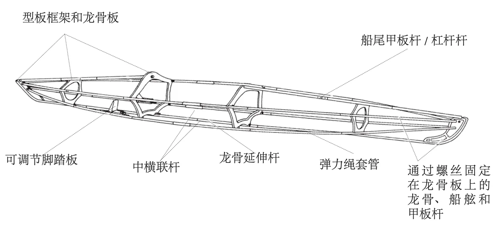

**框架组件：**

- 型板框架和龙骨板
- 船尾甲板杆/杠杆杆
- 可调节脚踏板
- 中横联杆
- 龙骨延伸杆
- 弹力绳套管
- 通过螺丝固定在龙骨板上的龙骨、船舷和甲板杆

---

## 维护与保养

### 框架保养

铝合金框架非常坚固，耐盐碱腐蚀。我们建议在使用（2-3个月）后拆卸框架进行保养。保养时铝管的内外都用淡水清洗。尽量保持插入件和延长杆没有沙子和异物。

在维修包内为您提供了一种优良的铝润滑剂和保护剂。在您维护的时候可以以喷涂保养。

如果你准备长时间不拆开皮划艇，可以在组装前，将润滑剂喷涂在框架管插入件、弹簧组件件和滑动件上。这将有助于防止管道卡住。

**其他保养注意事项：**

- 每两个月完全拆解一次羽船
- 用淡水完全清洗框架
- 使用润滑剂涂抹擦拭管子装配位置

### 蒙皮保养

划艇后，用海绵去除艇内部积水。不允许沿着龙骨管有积水。

蒙皮具有很好的耐腐蚀性能和抗老化性能，而且非常耐撕裂。在艇底，可能磨损的区域已得到加强。然而，我们建议在接近海岸时要小心。锋利的岩石和藤壶可以穿透蒙皮。永远不要把艇拖过岩石。

对于修补，在配件包内有一套补丁套件。内部有管道胶带可以进行快速的现场修复。

---

## 焊接密封蒙皮和独立气室

### 焊接密封蒙皮

聚合甲板和船体是聚氨酯焊接工艺加工。接缝是永久密封的。

为甲板、船体或临时穿刺提供了一个补丁套件。一种聚氨酯胶水可以用于修理所有这些织物。胶水有保质期，保质期内是液体，不粘稠。我们有提供胶水单独销售。

### 独立气室

由于蒙皮与骨架的紧密配合，独立气室处于相当大的压力下，可能会发生一些空气渗漏。建议定期重新充气。在炎热的日子里划桨后，释放独立气室内的空气。

### 修理 / 更换充气气室

气室可以从船体蒙皮内部轴子结构的简状位置安装到蒙皮内部。把蒙皮从里到外翻出来。气室包裹布料的船头和船尾部位是开放的。在独立气室末端标签的洞上系上一根长绳子。拉动独立气室的中心开口（连接连接软管的位置）可以在蒙皮内抽出气室配件。要重新安装气室，请将连接在新气室上的上的绳索穿到蒙皮布筒内拉动装配。确保气室在蒙皮布筒内没有扭曲。在另一侧重复上述操作。聚氨酯胶水和补丁都包含在维修工具包中。管道胶带在气室上的应用效果也很好。

---

## 拆解收纳

### 拆解步骤

首先放掉气室内的空气。拆下座舱圈舱加强条。拆卸坐兜连接杆。将杠杆插入到龙骨延伸杆中。用杠杆承受张力，以拆开龙骨延伸杆的卡簧。按照装配相反的顺序执行其余的拆解收纳步骤。

### 把羽船收入背包

先把坐垫平放在背包里，坐垫缓冲垫面朝下，可以为你的背部提供更多的衬垫。接下来，将白色的型胶板排放在座位上。将铝框架部件的型胶板放在座位的中心，在对折后卷起一把艇末端折叠到皮划艇的中心，在对折后卷紧；用织带固定。把这个捆绑好的蒙皮放在铝合金框架上。将所有额外的部件（如海袜，修理工具包）塞入其他任何可用的空间。

### 羽船的搬运

在船头和船尾的织带把手可用于提起羽船或携带搬运。切勿抬起或携带载的皮划艇。抬起携带装备的皮划艇，很有可能损坏铝合金框架。

### 羽船的存储

存储羽船必须保证清洁和干燥，羽船可以被组装状态或拆卸状态存储在一个阴凉干燥的地方。存放拆卸后的羽船时，应将延长杆完全分开成两个单独的零件。

---

## 羽船装配说明

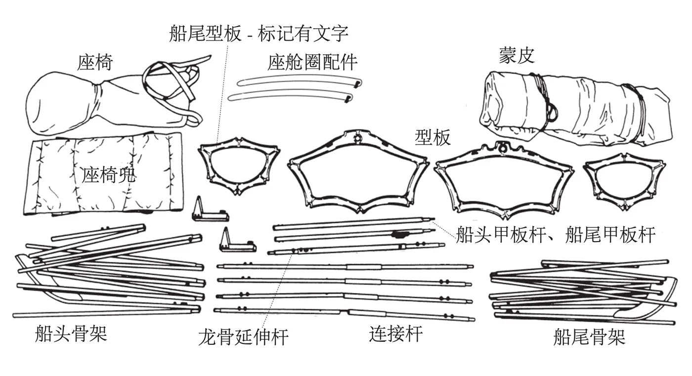

**组件说明：**

- 座椅
- 船尾型板 - 标记有文字
- 座舱圈配件
- 蒙皮
- 座椅兜
- 型板
- 船头甲板杆、船尾甲板杆
- 船头骨架
- 龙骨延伸杆
- 连接杆
- 船尾骨架

---

## 船头框架安装

### 步骤1-3

**1. 如图所示装配框架部件

**2. 展开船头框架（船头框架有脚踏板安装轨道）
- 用手抓住头部晃动，内部弹力绳会让框架自动成形。

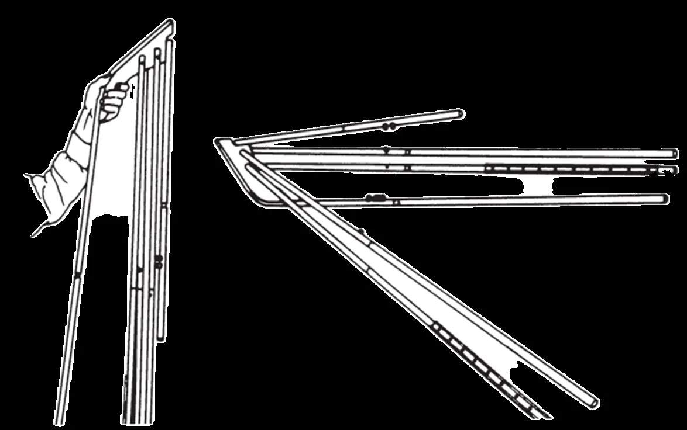

**3. 将船头小型板安装在船头骨架上。**

- 船头小型板上的金属销插入龙骨塑料块孔内，安装到位。
- 将下舷管和侧舷管固定到塑胶型板上。
- 当型板安装准确时，白色塑胶柱在型板面向"坐舱"一侧。

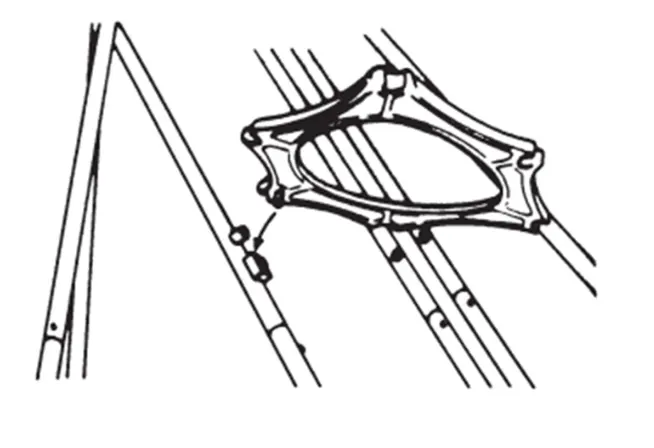

**4. 完成船头框架安装。**

- 将脚踏板零件沿着滑轨划入。

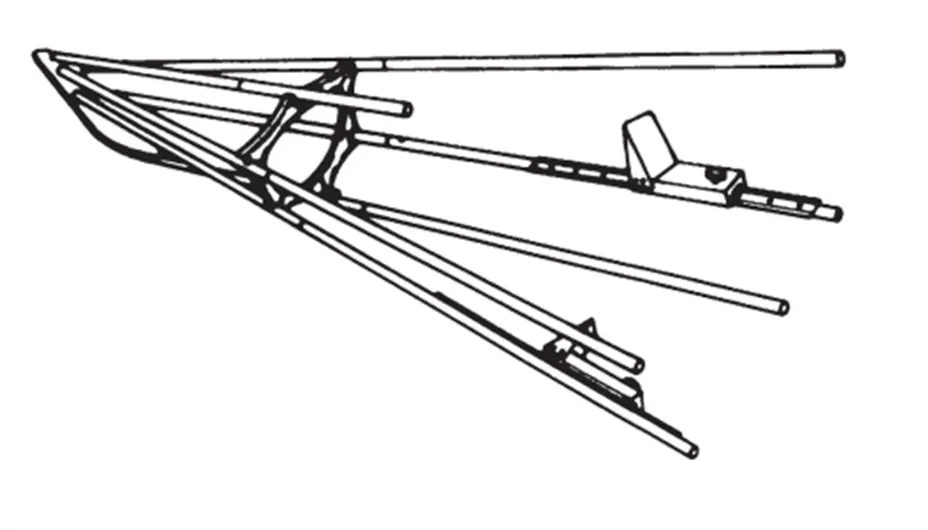

**5. 船尾框架安装**

重复上述步骤的2和3步。

---

## 展开蒙皮和插入框架

### 步骤6：展开蒙皮

通过驾驶舱口，在船体内部把船头船尾的两个魔术贴搭扣打开。

### 步骤7：将框架部分插入到蒙皮内部

在将框架插入蒙皮之前，请确保魔术贴搭扣是打开的。将船头和尾部框架部分滑入蒙皮中。

当插入框架部分时，使用魔术贴搭扣作为基准对齐框架和蒙皮中心。将框架部分推进到蒙皮的最顶端。在龙骨杆上扣上魔术贴搭扣。

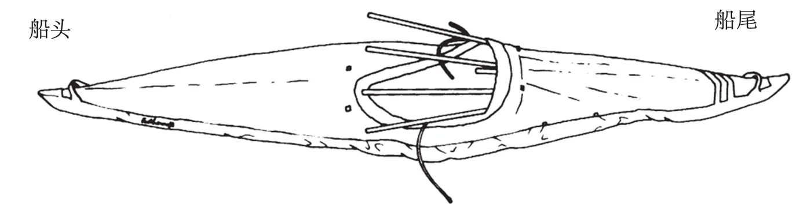

---

## 安装龙骨延伸杆

### 步骤8：安装龙骨延伸杆

先将延伸杆的尾端滑动到船尾龙骨杆上。将横杆拉长，将另一端连接到船头龙骨杆上。

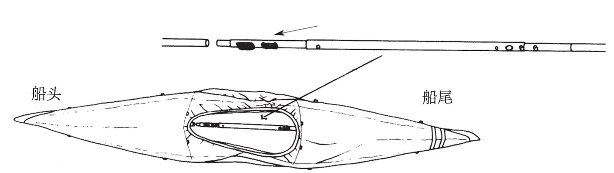

---

## 展开龙骨延伸杆和安装座舱圈

### 步骤9：展开龙骨延伸杆

横杆使用船头甲板杆、垂直杆使用船尾甲板杆搭配使用展开龙骨延伸杆，直到弹出弹簧按钮。

将龙骨延伸杆扩展到第二孔或第三孔你应该感到很大阻力，注意不要使用极端的力。

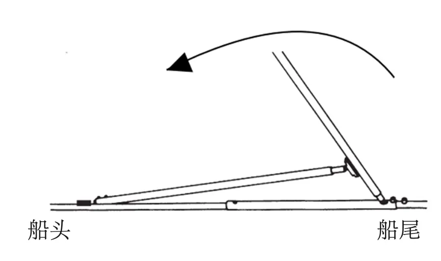

### 步骤10：安装座舱圈配件

滑入蒙皮座舱圈外套边缘底部的口袋中。

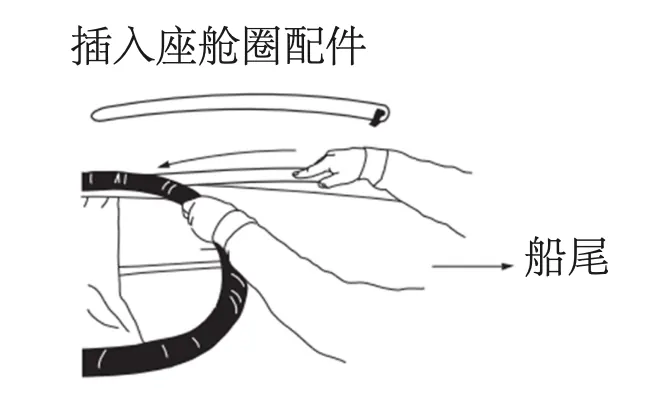

---

## 安装座椅兜

### 步骤11：安装座椅兜

座椅兜的尾部座椅位置的缝线较窄。
将连接杆穿过吊索中的缝纫圆筒，套管部分带朝向船头。（羽船45的安装和龙骨延长杆方向一致）

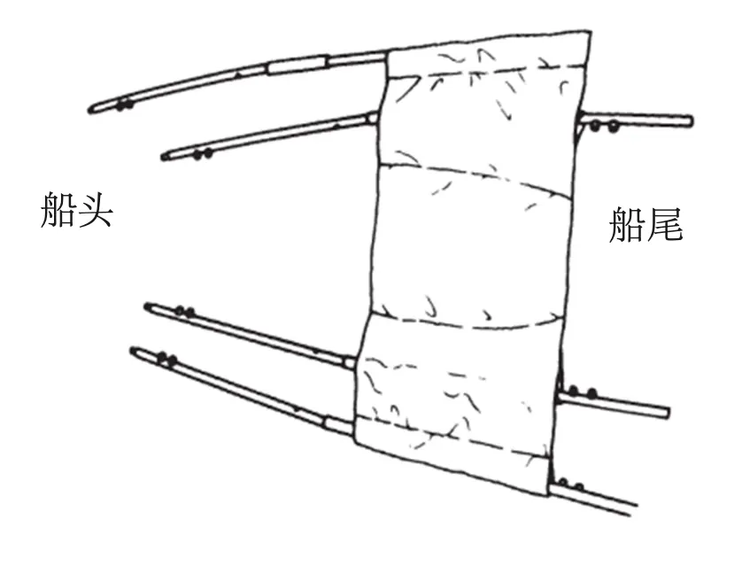

---

## 安装中间套管接头

**注意：** 在艇安装框架部件时，人位于对侧更容易安装。

### 步骤12：安装中间套管接头

一旦船头和船尾的框架部分被插入到蒙皮内，它们会形成皮艇的弯曲形状。当管子彼此之间呈直线排列时，可以更容易地将管子滑动在一起。

安装中间连接器时，将尾杆拉向皮艇中心。滑动到中间管的后端。向前拉中间套管，延伸弹力绳。中间的管将会"重叠"

中间管的两端现在对接到一起，推动中间管"向外"到蒙皮的外部。当中间连接管对准时，向蒙皮中心向后拉，并滑动套筒连接。

**操作要点：**

- 将管相互对直，以更容易滑动
- 弹力绳拉出，让管子重叠
- 将连接管对接在一起
- 套管套上

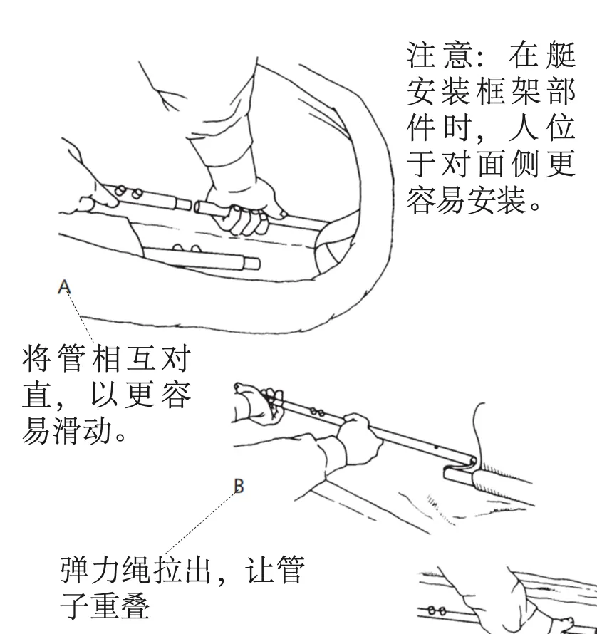

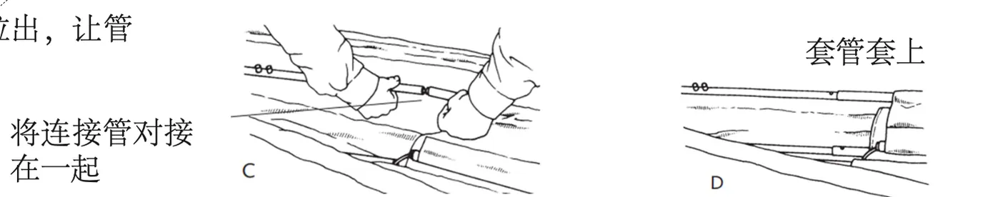
---

## 羽船45的座椅兜延伸杆

羽船45的安装方式与龙骨延长杆相同

横杆使用船头甲板杆、垂直杆使用船尾甲板杆搭配使用展开座椅兜延伸杆，直到弹出弹簧按钮。

将座椅兜延伸杆扩展到第二孔或第三孔你应该感到很大阻力，注意不要使用极端的力。

---

## 安装大型型板

**注意：** 此步骤在框架装配到蒙皮内完成。为了说明，我们展示了没有蒙皮的框架。

### 步骤13：安装大型型板

放置大的型板放置在侧舷管的顶部。向前滑向侧舷管上的销。将型板旋转到适当位置。将型板向上推到末端并卡入到位，将型板置于离你们最近的型板架销之间。

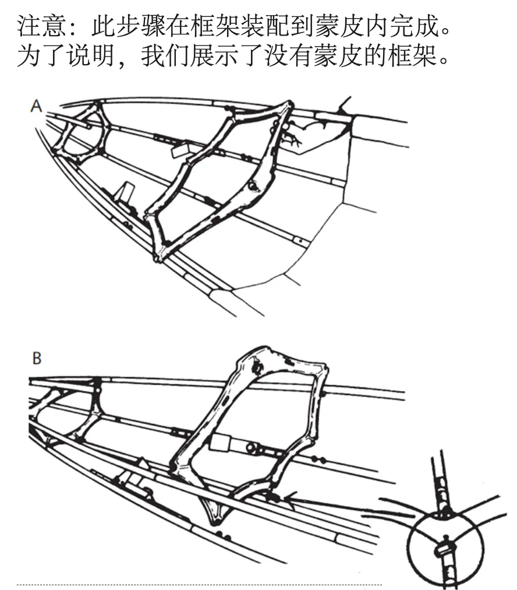

#### 安装船头型板

龙骨杆上安装了两块黑色的塑料块。一个是安装了螺丝，可以旋转。当旋转远离另一个块时，它处于"打开"位置。将方块设置为"打开"位置。

将位于型板底部的销插入龙骨杆上的黑色块中。将第二个方块扭曲到"关闭"位置。在船舷杆上扣到缺口位置，然后是下船舷杆。

### 步骤14：安装船尾大型型板

步骤和船头型板相同。

---

## 固定甲板织带和安装船头甲板栏杆

### 步骤15：将甲板织带固定到型板上

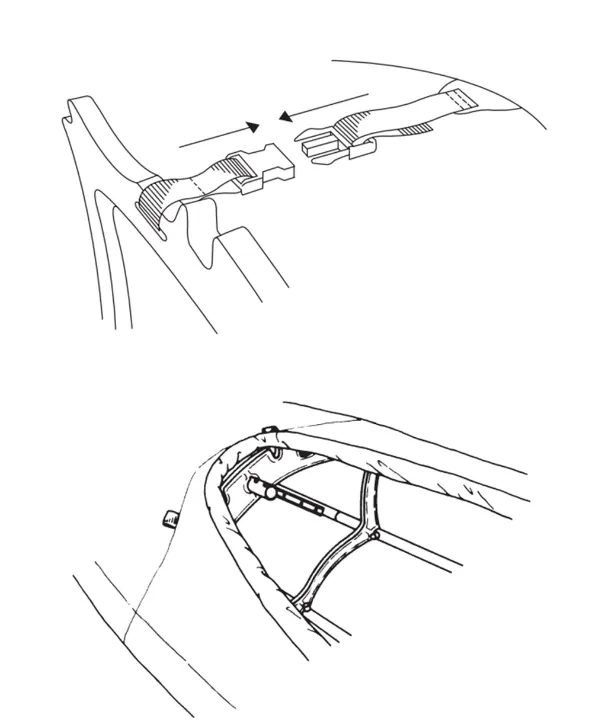

在甲板的下面，在大的尾部型板后面，是带扣的织带。绑住型板后拉紧。

### 步骤16：安装船头甲板栏杆

通过大型型板顶部的小孔插入。连接到防震绳连接的甲板杆。贴紧甲板。转向甲板杆以锁定到位。

---

## 安装船尾甲板杆

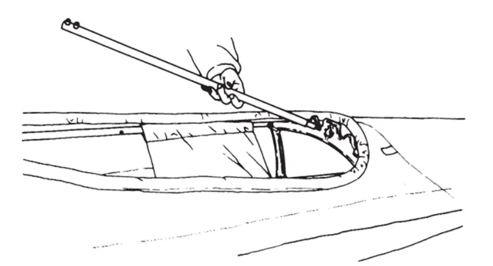

### 步骤17：安装船尾甲板杆

把船尾甲板杆从艇内部穿过大的型板中心；末端以黑色的方块一端指向船尾。

把甲板杆头部接近你的一端，通过型板顶部的小洞。连接船尾甲板杆，插入到弹力绳固定的甲板杆。按住弹力绳甲板杆，同时转动甲板杆锁定到位（正如您在第15步中所做的那样）。

确保甲板杆上的两个小柱子不向上，转动向艇内部。

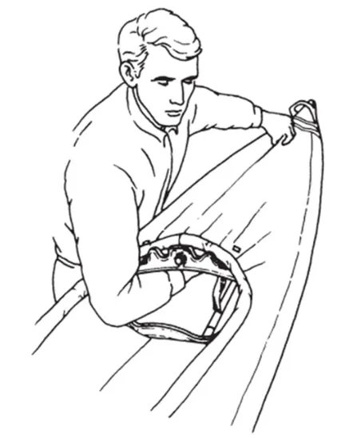

---

## 安装座舱圆支撑杆

型板支撑杆有白色销钉。型板上有安装孔。

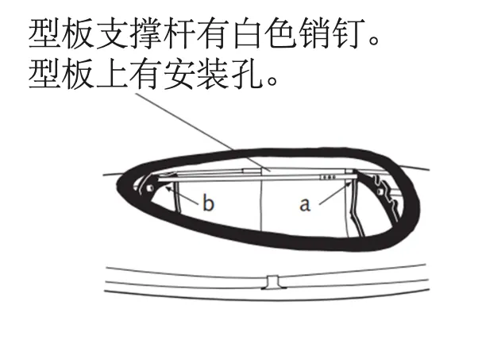

### 步骤18：安装座舱圆支撑杆

将支撑杆上的套管向船头滑动。将管（a）的船尾端穿过大型船尾型板中的孔。将弓头（b）穿过船头型板中的孔插入。向船尾滑动套筒，直到弹簧按钮出现在第二个孔中。

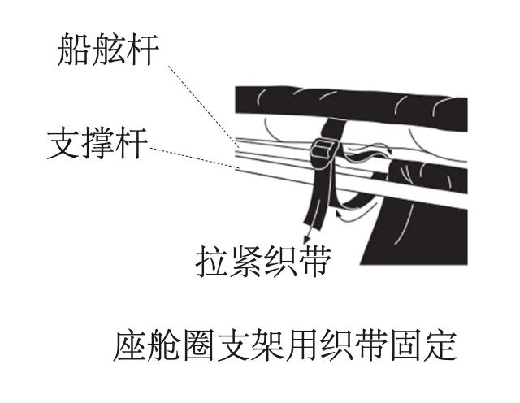

---

## 安装座椅和充气

### 步骤19：安装座椅

座椅顶部的织带穿过船尾型板，在顶部连接好插扣。
在座位前面的织带穿过船头固定型板，并在型板的一侧绕过。连接到座椅上的锁扣固定。

**注意：** 织带位于下舷杆上方。

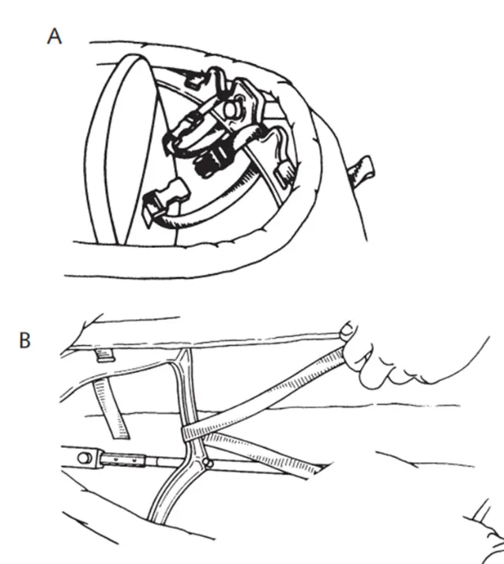

### 步骤20：给独立气室充气

转动阀门的顶部打开气阀。当充气的时候，左右两侧交替充气，以确保框架在中心。来自独立气室的空气压力可以改变蒙皮内的框架位置。持续吹气直到蒙皮边的紧致。扭转顶盖以关闭气阀。将气管阀门塞出驾驶舱区域。避免踩上软管和阀门，并保持阀门无异物状态。

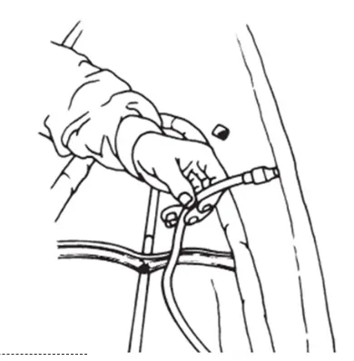

---

## 海袜介绍

海袜由高密度的防水聚合制作而成，海袜是一个优秀的安全产品。可以防止蒙皮骨架折叠皮划艇仓内进水。海袜的顶部紧密地安装在座舱圈上。配合座椅后座和底部，前面松散地穿过座舱，创造了一个独立的密闭空间。划艇的人坐在海袜里，身体和脚不受限制。防水裙可以和平时一样安装使用。如果发生大浪或者侧翻，水只会进入海袜，而不会进入仓内。海袜也可以有效的保持你的皮艇内部清洁。

### 关于使用和安装的技巧

- 织物闪亮的一侧朝向皮艇框架
- 当面对皮艇的船头时，公司标志的文字logo 应该在右侧
- 海袜上部的中心缝应以座舱船头点为中心
- 海袜安装好后，如果防护袋不能蓬松出自自由空间，可以坐在海洋防护袋里，把边缘位置拉开一个缝隙，释放出皮划艇内被困的空气，让海袜蓬松出来自由空间

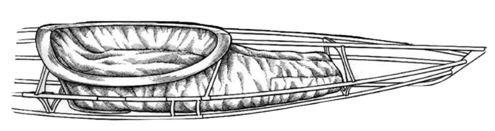

---

## 可选配件的安装

为了安装可选的冲浪方向舵，方向舵支架被永久地连接在皮艇的船尾。

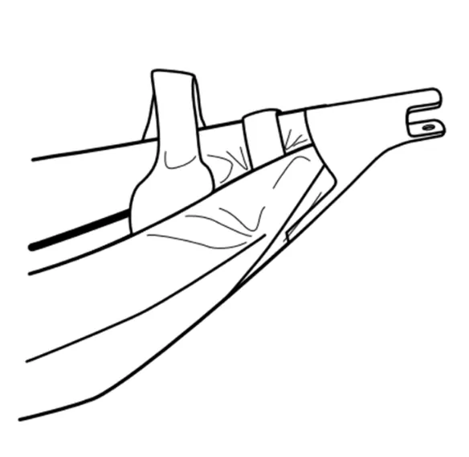

---

## 安装方向舵

将方向舵销插入"钥匙孔"。旋转方向舵180度。

用姊妹夹子连接方向舵控制绳。白色的牵引绳被固定在驾驶舱的一侧。

姊妹夹（两个夹安装在方向舵的两侧）。

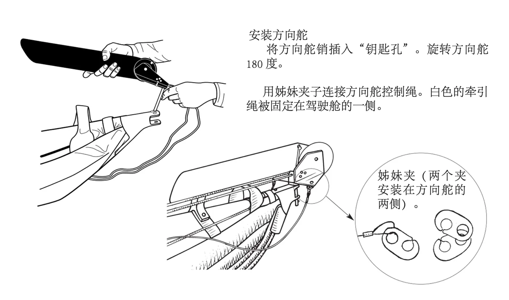

---

## 连接方向舵控制到脚踏板

红色的织带调节器连接到脚踏板上。拧下脚踏板上的梅花螺丝；螺丝穿过金属扣眼。为了使控制绳更短，折叠织带到第二个金属扣上。将梅花螺丝重新锁到脚踏板上。滑动脚踏板进行测试。确保踏板能在轨道上轻松滑动。（如果没有，请检查您重新锁定的梅花螺丝。）

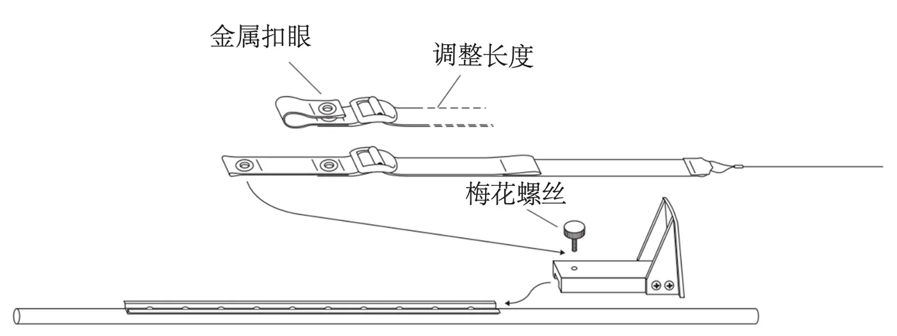

---

## 调节日字扣

日字扣折叠成为V字形状。调节日字扣带拉环的织带。

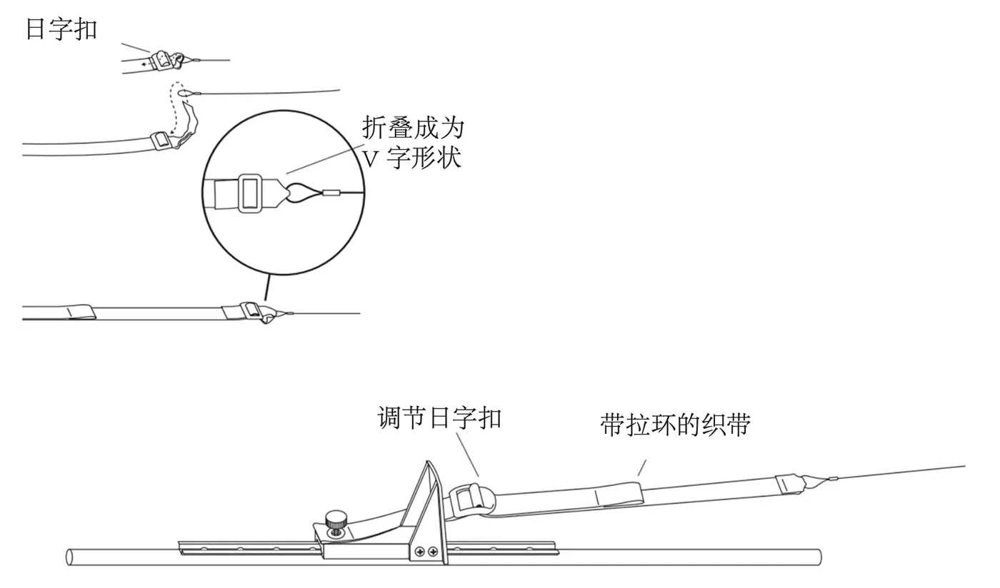

---

## 安装可选的舱口

连接舱口圈。通过折叠缝在甲板上的织物袖子来连接舱口密封圈。卷起后用插扣锁定。将舱口盖放在边缘上，用B形锁固定。

**拆卸时，不要忘记去掉塑料轮圈。不要在内部没有拆掉塑胶轮圈的时候把蒙皮卷起来。**

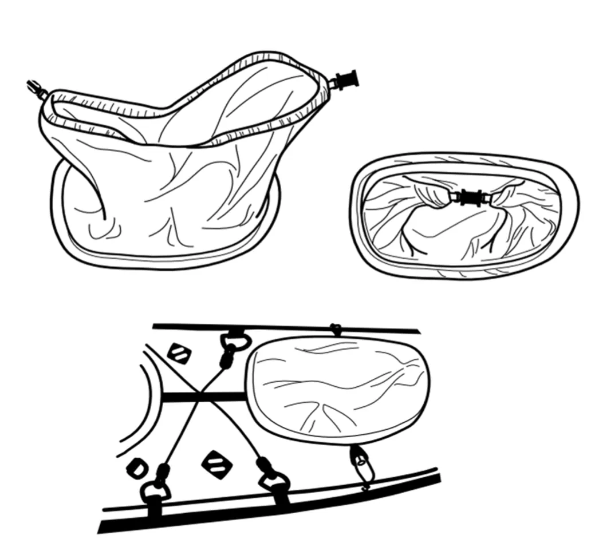

---

---

*苏州澎逸运动用品有限公司 2023 年在中国印刷。可回收纸张*

---

> **转载声明**：本文转载自澎逸运动用品《澎逸羽船系列》官方文档（[原文 gitee 仓库](https://gitee.com/feathercraft/pengyikayak)），
> 经作者吴树升先生授权以 **CC BY-SA 4.0** 许可公开，转载请署名并以相同方式共享。
