# 澎逸羽船45座椅DIY改装指南

## 基本信息
- **作者**：毛阿茂  
- **日期**：2025年9月20日  
- **目标**：为澎逸羽船45安装DIY座椅，改善长时间乘坐舒适性

## 一、材料清单
| 序号 | 材料名称 | 规格/说明 | 数量 | 单价 | 小计 |
|------|----------|-----------|------|------|------|
| 1 | 划船机发泡坐垫 | 尺寸约32×26cm | 1个 | 45元 | 45元 |
| | 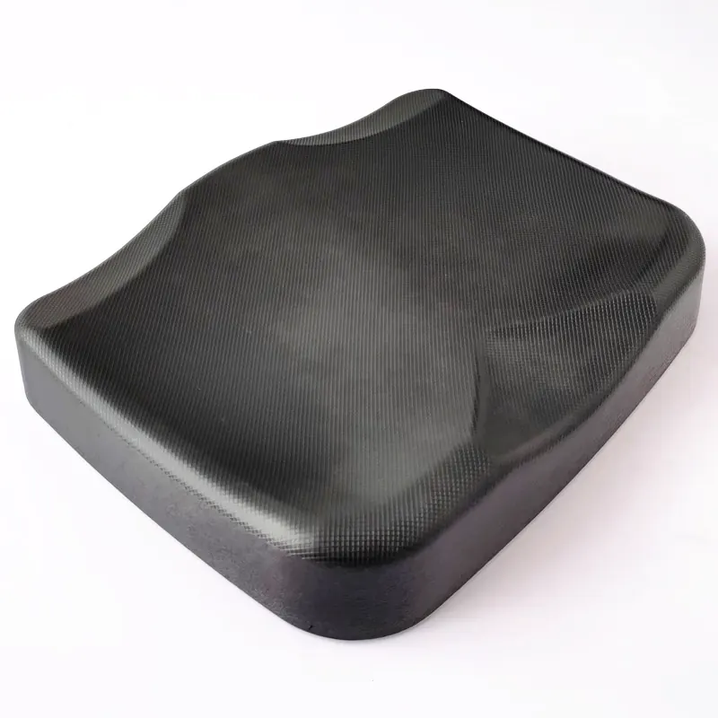 | 
| 2 | 20mm两通连接件 | 镀锌，厚1.8mm | 4个 | 1.3元 | 5.2元 |
| | 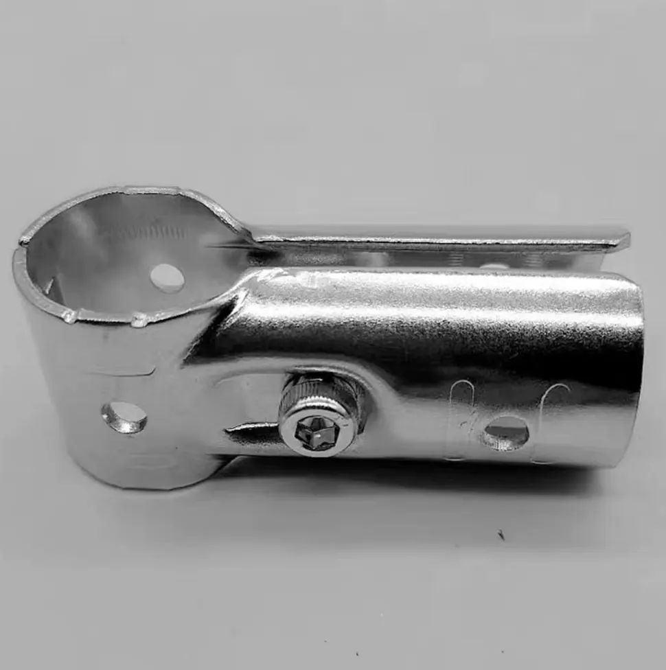 | 
| 3 | 圆管连接件（短三通） | 4分，适用外径20mm钢管 | 4个 | 1.8元 | 7.2元 |
| | 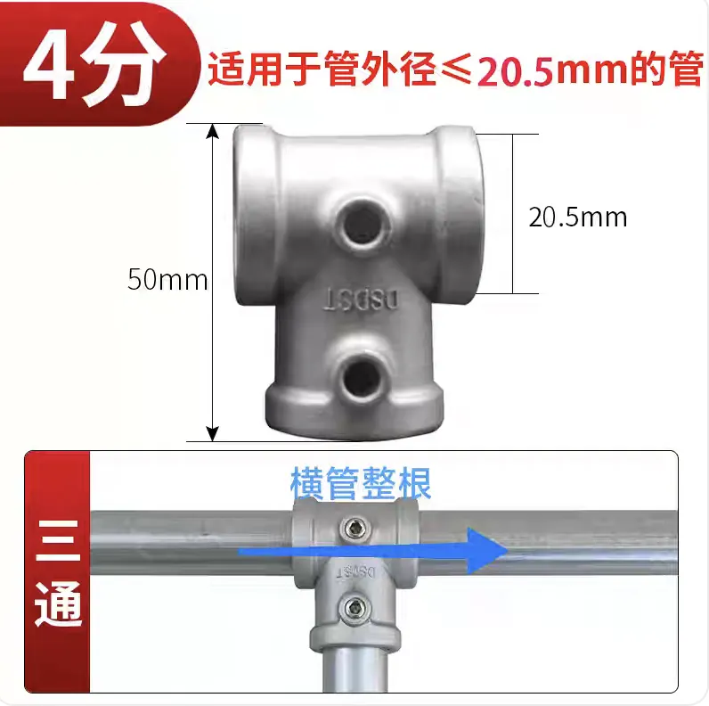| 
| 4 | 定制6061铝管 | 壁厚1.5–5mm均可 | 2根 | 15元 | 30元 |
| | 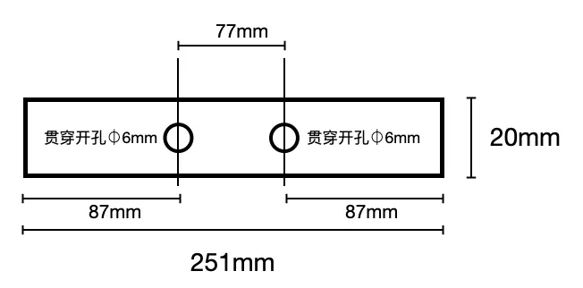 | 
| 5 | 304不锈钢十字槽凹穴外六角螺丝带平弹垫 | 外六角 | 5颗 | - | 3元 |
| | 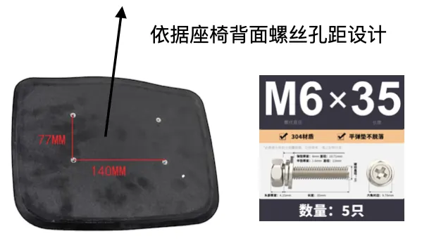 | 
| 6 | 定制6061铝管 | 壁厚1.5–5mm均可 | 2根 | 15元 | 30元 |
| | 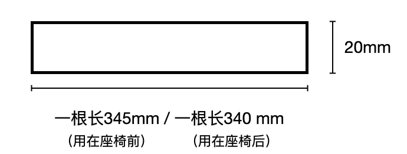 | 
| 7 | 尼龙扎带，推荐ABB | 型号：SKT300-230X-RU-100 | 100根 | - | 40元 |
| | 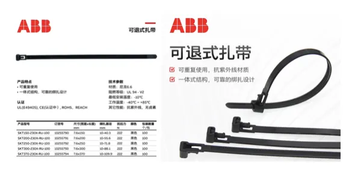 | 

## 二、安装步骤
### 步骤1：组装座椅与铝管
- 将发泡坐垫与**6061铝管**通过螺丝固定在一起。  
**注意**：建议使用6061铝材，因其硬度更高，更适合承重（6063铝也可选用）。  
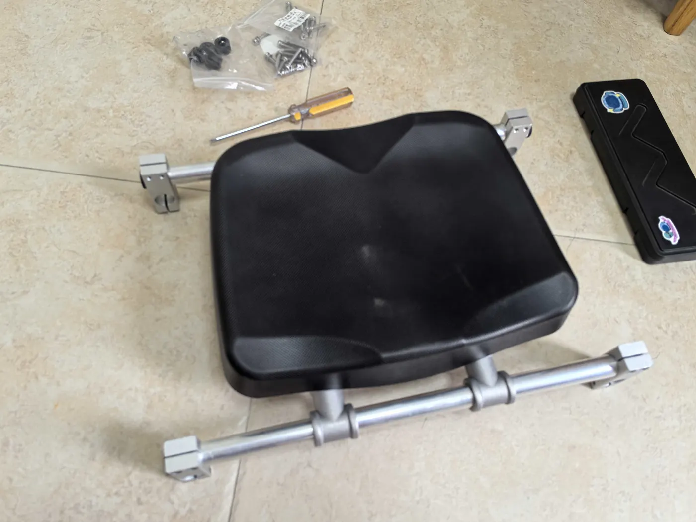

### 步骤2：拆除原座椅并安装新座椅
- 拆除羽船原有的座椅布兜，重新组装羽船。
- 使用连接件安装新座椅。
- **固定方法**：座椅下方的两根铝杆与龙骨需用质量较好的尼龙扎带，固定在前后大型板上。

## 三、座椅尺寸计算建议
### 精确计算公式
\[
D = \sqrt{L_{1}^{2} + L_{2}^{2} + L_{1}\cdot L_{2}}
\]
- **D**：坐骨结节到脚跟的距离  
- **L₁**：大腿长度  
- **L₂**：小腿长度  

### 快速估算公式
\[
D = 0.87 \times L
\]
- **L**：大腿长 + 小腿长（L₁ + L₂）  

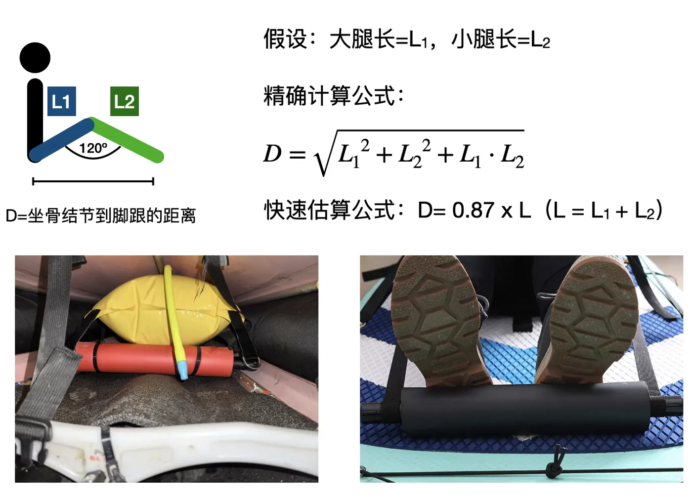

## 四、最终效果展示
- **座椅整体效果**：
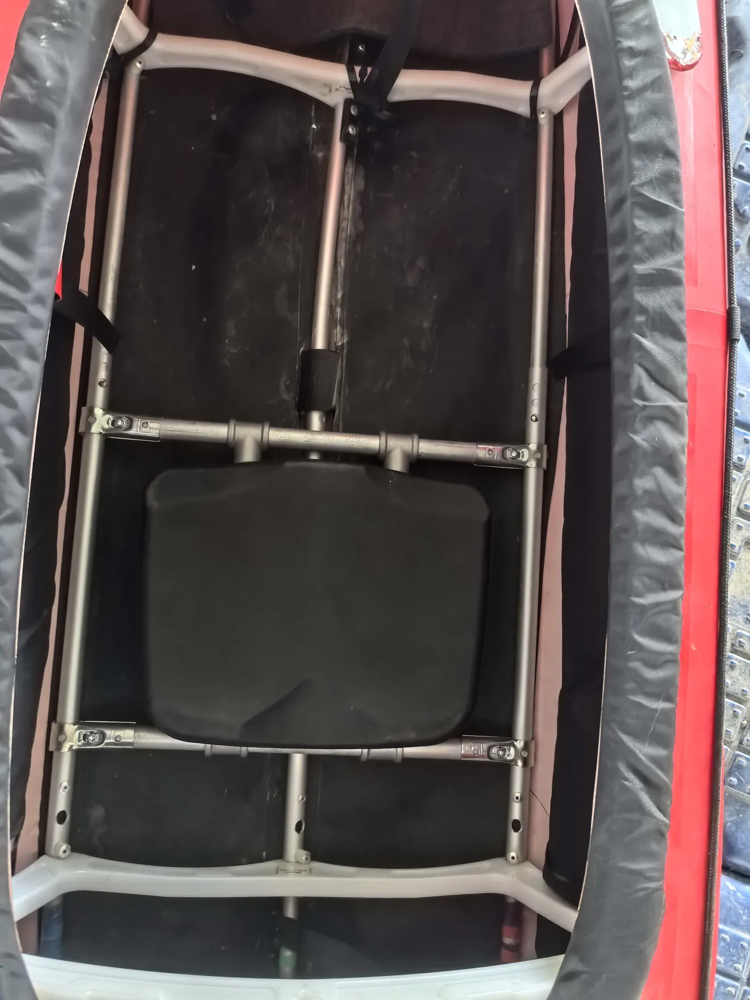
 
- **靠背效果**：
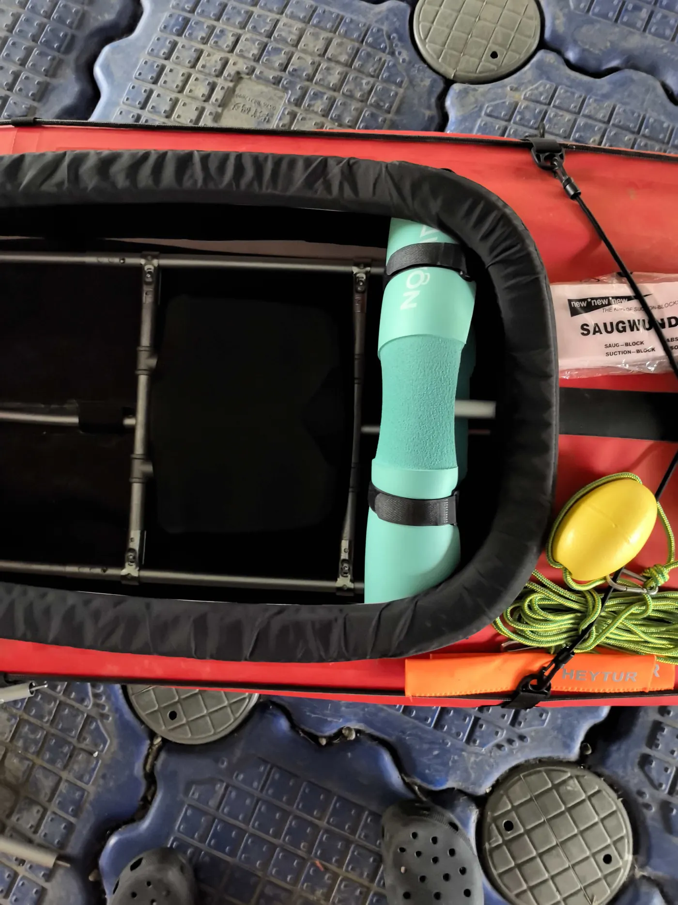  

## 五、注意事项
1. 铝管建议选择6061材质，以保证承重安全性。
2. 安装时确保连接件与铝管、船体结合紧密。
3. 建议使用质量可靠的尼龙扎带进行加固。

---

**感谢使用本指南，祝您改装顺利！**

---

> **转载声明**：本文转载自澎逸运动用品《澎逸羽船系列》官方文档（[原文 gitee 仓库](https://gitee.com/feathercraft/pengyikayak)），
> 经作者吴树升先生授权以 **CC BY-SA 4.0** 许可公开，转载请署名并以相同方式共享。
