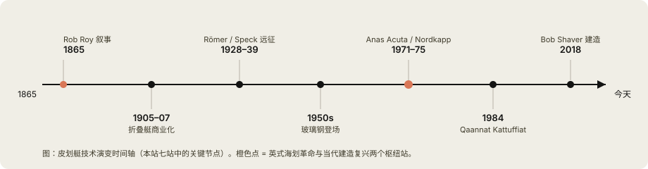
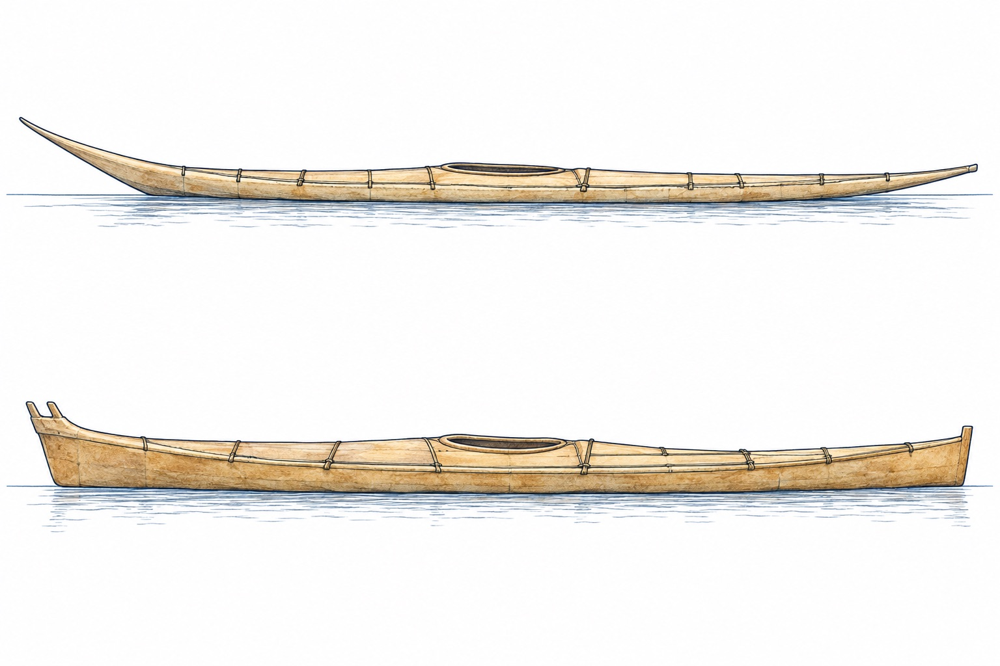

# 演变路线

一条时间轴，从格陵兰狩猎艇走到今天的中文知识库。这一页给你**全景图**：时间轴在哪、
七个站点各是什么、哪几站已经展开成详页。30 秒看完本页，就可以跳进任何一站。

## 路线图

| 站 | 年代 | 代表船型 | 关键技术 | 证据源 |
|---|---|---|---|---|
| ① 格陵兰狩猎艇 | ~1600s起 | qajaq（海豹皮木框） | 狩猎滚法体系、量体裁衣 | 《Eastern Arctic Kayaks》Heath & Arima 2004 |
| ② 欧洲折叠艇 | 1907起 | Klepper 折叠艇 | 便携化、军用与远征 | 《Alone at Sea》Lindemann 1958（1956乘Klepper横渡） |
| ③ 英国海划革命 | 1970s | Anas Acuta / Nordkapp | 海划艇设计范式、远征级适航 | 详页已建（wiki+GPT审阅口径） |
| ④ 现代艇型分化 | 1990s起 | 塑料/复合量产艇 | 量产、罗陀螺化 | 澎逸说明书（CC）/市售艇 |
| ⑤ 格陵兰复兴 | 1984起 | 传统工艺重建 | Qaannat Kattuffiat、滚法竞技化 | Qajaq USA / 格陵兰冠军赛 |
| ⑤b 北美西海岸复兴 | 1990s–2000s | Harvey Golden 收藏研究 / Cape Falcon 图纸 | 蒙皮框艇建造全球DIY普及 | 待核：Golden《Kayaks of Greenland》/ Cape Falcon 免费建造手册 |
| ⑥ 中国支脉 | 2010s起 | 澎逸羽船等国产折叠艇 | 国产化、大众化 | 澎逸组装说明书（CC授权） |

## 各站导读

*AI 生成示意图（gpt-image-2.6-flare，2026-11，经人工验收）：上=格陵兰式 qajaq（长悬挑上翘艏/低甲板），下=阿留申式 baidarka（短平直艏/分叉双艏）——船头特征即两母型的辨识钥匙。*

- **①狩猎起源**：艇为猎人之衣，尺寸按猎人体型定制——这是格陵兰艇"不合身就滚不起来"的根源，
  也是后续一切技巧体系的原点（[详页](greenland-qajaq.md)）
- **②折叠支脉**：Lindemann 用 1956 年的 Klepper 证明皮肤框艇理念可工业化便携化
- **③英国革命**：玻璃钢 + Nordkapp 级远征设计，把海划推向大众运动——[英式海划革命](british-sea-kayak.md)
- **④量产终态**：材料革命收官，设计语言重新回到①的原始约束
- **⑤格陵兰复兴**：Qaannat Kattuffiat 1984 年成立，把濒危的滚法技艺竞技化保存下来；
  今天全球的 Greenland Paddle 复兴与这场运动深度交织
- **⑥中国支脉**：澎逸把折叠艇价格打到大众可及，羽船说明书本身就是演变史的一手材料

## 详页写作口径（本站承诺）

每个详页承诺三件事：**事实经过 GPT 交叉审阅并留修订记录**（审稿件在仓内
`pipeline/reviews/`）、**每个数字可溯源**（正文 `^[出处]` 标记）、**分歧口径并列呈现**
（不假装存在唯一"标准答案"）。

## 与格陵兰专栏的关系

演变路线是"骨"，[格陵兰专栏](../greenland/index.md)是"肉"——技巧、滚法、构造细节都长在
这条骨架上。
